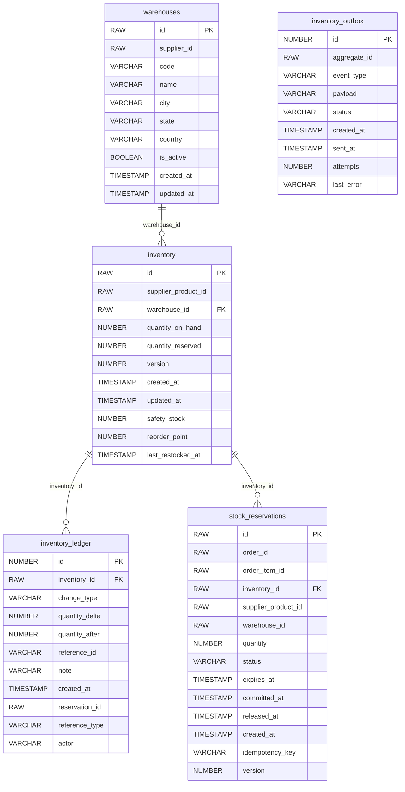

# ShopTrail Inventory Manager

The source of truth for stock in ShopTrail: quantities per warehouse, reservations for orders, and a full ledger.

Part of **ShopTrail**, a multi-seller marketplace. Full system reference: [`marketplace_tdd.md`](https://github.com/RaghuMHulkoti/shoptrail/blob/main/docs/marketplace_tdd.md).

| | |
|---|---|
| Live | https://inventory-manager-8q64.onrender.com |
| Swagger UI | https://inventory-manager-8q64.onrender.com/swagger-ui.html |
| Health | https://inventory-manager-8q64.onrender.com/actuator/health |
| Local port | `8080` |
| Database | Oracle Autonomous DB, schema `INVENTORY` (Flyway) |
| Stack | Java 21, Spring Boot 4.0, Spring Data JPA, Flyway, Spring Kafka |

## Responsibilities

- Stock per supplier product and warehouse (`on hand`, `reserved`, safety stock, reorder point).
- Bulk stock upload with per-row results.
- Reserve stock for orders (from `ORDER_CREATED`), deduct on confirmation, release on cancellation.
- Ledger of every stock change.
- Availability queries for cart.

## How it fits

- Kafka: consumes `domain.order.events` (`ORDER_CREATED`), produces `domain.inventory.events`.
- REST in: order-service (deduct, release), cart-service (availability), the seller portal (warehouses, bulk upload).

## Run locally

Prerequisites: JDK 21+, Maven wrapper (included), the Oracle wallet of the shared database.

```bash
export DB_PASSWORD=...                       # Oracle password (never commit it)
export WALLET_DIR=/path/to/Wallet_ECOMMERCE  # unzipped Oracle wallet
./mvnw spring-boot:run
```

Open http://localhost:8080/swagger-ui.html.

### Tests

```bash
./mvnw test
```

Tests run on H2 in Oracle mode.

### Docker

```bash
docker build -t shoptrail-inventory-manager .
docker run -p 8080:8080 -e DB_PASSWORD=... -e WALLET_CWALLET_B64="$(base64 < cwallet.sso)" shoptrail-inventory-manager
```

`docker-entrypoint.sh` unpacks the wallet from `WALLET_CWALLET_B64` when it is set.

## Configuration

All settings come from environment variables. Secrets have no defaults and must never be committed.

| Variable | Default | Purpose |
|---|---|---|
| `KAFKA_BOOTSTRAP_SERVERS` | `production-fgivv4.eu.cluster.ntail.io:9092` | Kafka cluster address |
| `KAFKA_SECURITY_PROTOCOL` | `SASL_SSL` | `SASL_SSL` for the cloud cluster, `PLAINTEXT` for a local broker |
| `KAFKA_USERNAME` | `default` | SASL/PLAIN user |
| `KAFKA_PASSWORD` | _(none, secret)_ | SASL/PLAIN password. Secret |
| `WALLET_DIR` | a local path | Folder of the Oracle wallet (local runs). On Render set `WALLET_CWALLET_B64` instead |
| `DB_USERNAME` | `ADMIN` | Oracle user |
| `DB_PASSWORD` | _(none, secret)_ | Oracle password. Required, no default |
| `OTEL_EXPORTER_OTLP_ENDPOINT` | `http://localhost:4318` | OTLP endpoint for metrics push (active only with `OTEL_METRICS_EXPORTER=otlp`) |
| `OTEL_SERVICE_NAME` | application name | `service.name` resource attribute |
| `EVENTS_PUBLISHER` | `log` | `log` prints events; `kafka` publishes them |
| `EVENTS_CONSUMER_ENABLED` | `false` | `true` starts the Kafka listeners |
| `EVENTS_CREATE_TOPICS` | `true` | Create this service's topics at startup |
| `CORS_ALLOWED_ORIGINS` | _(empty)_ | Comma-separated browser origins allowed to call the API (read by `CorsConfig`) |
| `SERVER_PORT` | `8080` | HTTP port |

## API

Responses are wrapped as `{"status", "message", "body"}`.

| Method | Path | Purpose |
|---|---|---|
| POST | `/api/v1/warehouses` | Register a warehouse for stock |
| POST | `/api/v1/inventory/bulk-upsert` | Set stock for many supplier products (per-row results) |
| GET | `/api/v1/inventory/{supplierProductId}` | Stock across warehouses |
| GET | `/api/v1/inventory/availability` | Available quantity for products |
| POST | `/api/v1/inventory/reserve` | Reserve stock (also done from `ORDER_CREATED`) |
| POST | `/api/v1/inventory/release` | Release reservations (compensation) |
| POST | `/api/v1/inventory/deduct` | Commit reservations on confirmation |

## Data model

Schema `INVENTORY`. Full columns and constraints: [section 8 of the reference](https://github.com/RaghuMHulkoti/shoptrail/blob/main/docs/marketplace_tdd.md#8-data-model).



| Table | Holds | Created in |
|---|---|---|
| `warehouses` | Warehouses that hold stock, per supplier | `V1__create_inventory_schema.sql` |
| `inventory` | Quantity on hand and reserved per supplier product and warehouse | `V1__create_inventory_schema.sql` |
| `stock_reservations` | Reservations per order item with status and expiry | `V1__create_inventory_schema.sql` |
| `inventory_ledger` | Every stock change | `V1__create_inventory_schema.sql` |
| `inventory_outbox` | Events waiting to be published | `V2__extend_inventory_schema.sql` |

## Events

**Consumes** `domain.order.events`: `ORDER_CREATED` reserves stock for every item. Failures retry three times and then go to `domain.order.events.dlq`.

**Publishes** to `domain.inventory.events` (keyed by order id): `INVENTORY_RESERVED`, `INVENTORY_RESERVATION_FAILED`.

## Background jobs

| Job | Schedule | Does |
|---|---|---|
| `InventoryOutboxPoller` | every 1 s | Publishes pending outbox rows |

## How it works

- **Available** = on hand minus reserved. Reservations move stock from available to reserved; deduct removes it from on hand; release returns it.
- **Concurrency:** optimistic locking (`version`) on inventory and reservations; reservation requests are idempotent by key.
- **Ledger:** each change writes `inventory_ledger` with type, delta, quantity after, reference and actor.

## Deployment

- Render web service (Docker), deployed manually or with `render deploys create <service-id>`.
- Set at least: `DB_PASSWORD`, `WALLET_CWALLET_B64`, `CORS_ALLOWED_ORIGINS` (seller portal and order console origins), `KAFKA_PASSWORD`, `EVENTS_PUBLISHER=kafka`, `EVENTS_CONSUMER_ENABLED=true`.
- CI: `.github/workflows/maven.yml` runs `mvn test`, builds the image, smoke-tests the container and pushes it to `ghcr.io`.
- Observability: `/actuator/health` (liveness and readiness probes), Prometheus at `/actuator/prometheus`, optional OTLP push.

## Known gaps

- Endpoints are open; no JWT or role check yet.
- Expired reservations are not released by a job; order-service releases them on cancel or timeout.
- Reorder alerts are not built (the columns exist).
