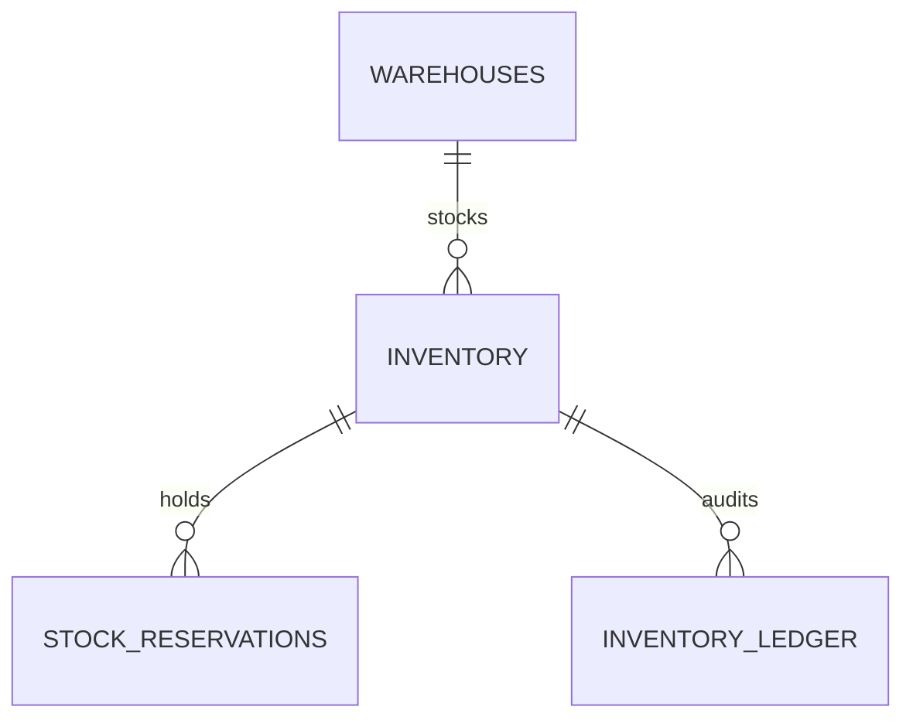

<div align="center">
  <h1>📦 Inventory Manager</h1>
  <p><em>The source of truth for stock, reservations, and fulfilment logic.</em></p>

  
  
  
  
  
</div>

---

## 📖 Overview

The **Inventory Service** is a core microservice in our E-Commerce Marketplace platform. It serves as the absolute single source of truth for stock availability across all suppliers and warehouses.

Unlike monolithic catalogs, this service is explicitly decoupled from product definitions and pricing. Its sole responsibility is guaranteeing the strongest promise in commerce: **no overselling, no double-charging, and no lost orders.**

## ✨ Key Features

- **Reservation-Based Stock:** Holds stock temporarily during the checkout window using TTL-based reservations to prevent overselling without permanently blocking inventory.
- **Optimistic Locking:** Designed for massive concurrency and flash-sale bursts using `@Version` fields.
- **Clean Architecture:** Strict separation of core business logic (Processors, UseCases) from infrastructure (Gateways, Controllers).
- **Event-Driven Resilience:** Integrates with Kafka via the Transactional Outbox pattern, publishing state changes (`INVENTORY_RESERVED`, `INVENTORY_DEDUCTED`) with 100% atomicity.
- **Audit Ledger:** Maintains an append-only `inventory_ledger` for tracking every single stock movement, ensuring total financial and operational traceability.
- **Bulk Operations:** Highly optimized bulk upsert APIs for suppliers syncing thousands of SKUs at once.

## 🏗️ Architecture

This service is built using **Clean Architecture**.
- **Core Domain:** Pure Java objects (`Inventory`, `InventoryLedgerEntry`). Contains no framework dependencies.
- **Ports (Interfaces):** Defines how the outside world talks to the core (`Usecases`, `Processors`) and how the core talks to the outside world (`Gateways`).
- **Adapters:** REST Controllers, Spring Data JPA Repositories, Kafka Producers.

### High-Level Architecture

```mermaid
flowchart TB
    subgraph Clients
        Web[Web App]
        Mob[Mobile Apps iOS/Android]
        SP[Seller Portal]
        Adm[Admin Console]
    end

    CDN[CDN / Edge Cache]
    WAF[WAF + DDoS Shield]
    GW[API Gateway<br/>Spring Cloud Gateway]

    subgraph Edge
        Auth[Auth/OAuth2<br/>Keycloak / Cognito]
    end

    subgraph CoreServices["Core Microservices (Java 21 + Spring Boot)"]
        US[User Service]
        PS[Product Service]
        SS[Supplier Service]
        INV[Inventory Service]
        CART[Cart Service]
        OS[Order Service]
        PAY[Payment Service]
        NOT[Notification Service]
        SRCH[Search Service]
    end

    subgraph SupportingServices["Supporting Services"]
        REC[Recommendation]
        SHIP[Shipping]
        COUP[Coupon]
        REV[Review]
        ANL[Analytics]
    end

    subgraph DataPlane["Data Stores"]
        PGU[(Postgres<br/>users)]
        PGP[(Postgres<br/>products)]
        PGS[(Postgres<br/>suppliers)]
        PGI[(Postgres<br/>inventory)]
        PGO[(Postgres<br/>orders)]
        PGPAY[(Postgres<br/>payments)]
        REDIS[(Redis Cluster<br/>cache/session/locks)]
        ES[(Elasticsearch<br/>catalog index)]
        S3[(Object Store<br/>S3)]
    end

    subgraph Messaging
        KAFKA[(Apache Kafka<br/>event backbone)]
    end

    subgraph External
        Stripe[Stripe]
        Razor[Razorpay]
        Carriers[Shipping Carriers]
        SMTP[SMTP/SES]
        SMSP[SMS Provider]
        FCM[FCM/APNs]
    end

    Web & Mob & SP & Adm --> CDN --> WAF --> GW
    GW --> Auth
    GW --> US & PS & SS & INV & CART & OS & PAY & SRCH
    GW --> REC & SHIP & COUP & REV

    US --> PGU
    PS --> PGP
    SS --> PGS
    INV --> PGI
    OS --> PGO
    PAY --> PGPAY
    CART --> REDIS
    SRCH --> ES

    US & PS & SS & INV & CART & OS & PAY & NOT & SRCH & REC & REV & ANL <--> KAFKA

    PAY <--> Stripe & Razor
    SHIP <--> Carriers
    NOT --> SMTP & SMSP & FCM

    PS --> S3
```



### Database Design

The service owns the `inventory_db` PostgreSQL database, partitioned logically around warehouses, inventory records, stock reservations, ledger, and outbox.

#### ER Diagram



#### SQL Schema

```sql
-- =====================================================================
-- INVENTORY DB  (SOURCE OF TRUTH FOR STOCK)
-- =====================================================================
CREATE TABLE warehouses (
    id           UUID PRIMARY KEY DEFAULT gen_random_uuid(),
    supplier_id  UUID NOT NULL,                       -- ref to Supplier Service
    code         VARCHAR(40) NOT NULL,
    name         VARCHAR(120) NOT NULL,
    country      CHAR(2) NOT NULL,
    region       VARCHAR(60),
    is_active    BOOLEAN NOT NULL DEFAULT TRUE,
    created_at   TIMESTAMPTZ NOT NULL DEFAULT now(),
    UNIQUE (supplier_id, code)
);
CREATE INDEX idx_wh_supplier ON warehouses (supplier_id);

-- one row PER (supplier_product, warehouse)
CREATE TABLE inventory (
    id                  UUID PRIMARY KEY DEFAULT gen_random_uuid(),
    supplier_product_id UUID NOT NULL,                -- ref to Supplier Service
    warehouse_id        UUID NOT NULL REFERENCES warehouses(id),
    quantity_on_hand    INT  NOT NULL CHECK (quantity_on_hand >= 0),
    quantity_reserved   INT  NOT NULL DEFAULT 0 CHECK (quantity_reserved >= 0),
    safety_stock        INT  NOT NULL DEFAULT 0,
    reorder_point       INT  NOT NULL DEFAULT 0,
    last_restocked_at   TIMESTAMPTZ,
    version             BIGINT NOT NULL DEFAULT 0,    -- optimistic lock
    created_at          TIMESTAMPTZ NOT NULL DEFAULT now(),
    updated_at          TIMESTAMPTZ NOT NULL DEFAULT now(),
    CONSTRAINT chk_qty_reserved_le_onhand CHECK (quantity_reserved <= quantity_on_hand),
    UNIQUE (supplier_product_id, warehouse_id)
);
-- "available_qty" is derived: quantity_on_hand - quantity_reserved
CREATE INDEX idx_inv_supplier_product ON inventory (supplier_product_id);
CREATE INDEX idx_inv_low_stock ON inventory (supplier_product_id) WHERE (quantity_on_hand - quantity_reserved) <= safety_stock;

CREATE TABLE stock_reservations (
    id                  UUID PRIMARY KEY DEFAULT gen_random_uuid(),
    order_id            UUID NOT NULL,
    order_item_id       UUID NOT NULL,
    inventory_id        UUID NOT NULL REFERENCES inventory(id),
    supplier_product_id UUID NOT NULL,
    warehouse_id        UUID NOT NULL,
    quantity            INT  NOT NULL CHECK (quantity > 0),
    status              VARCHAR(20) NOT NULL DEFAULT 'HELD'
                        CHECK (status IN ('HELD','RELEASED','COMMITTED','EXPIRED')),
    expires_at          TIMESTAMPTZ NOT NULL,
    committed_at        TIMESTAMPTZ,
    released_at         TIMESTAMPTZ,
    idempotency_key     VARCHAR(80) NOT NULL,
    version             BIGINT NOT NULL DEFAULT 0,
    created_at          TIMESTAMPTZ NOT NULL DEFAULT now(),
    UNIQUE (idempotency_key)
);
CREATE INDEX idx_resv_order        ON stock_reservations (order_id);
CREATE INDEX idx_resv_status_exp   ON stock_reservations (status, expires_at);
CREATE INDEX idx_resv_inv          ON stock_reservations (inventory_id) WHERE status = 'HELD';

CREATE TABLE inventory_ledger (
    id                  BIGSERIAL PRIMARY KEY,
    inventory_id        UUID NOT NULL REFERENCES inventory(id),
    change_type         VARCHAR(30) NOT NULL
                        CHECK (change_type IN ('RESTOCK','RESERVE','RELEASE','DEDUCT','ADJUSTMENT_PLUS','ADJUSTMENT_MINUS','RETURN')),
    quantity_delta      INT NOT NULL,
    quantity_after      INT NOT NULL,
    reservation_id      UUID,
    reference_type      VARCHAR(30),                   -- ORDER, RETURN, MANUAL...
    reference_id        VARCHAR(80),
    actor               VARCHAR(80),
    note                TEXT,
    created_at          TIMESTAMPTZ NOT NULL DEFAULT now()
);
CREATE INDEX idx_ledger_inv_time ON inventory_ledger (inventory_id, created_at DESC);

CREATE TABLE inventory_outbox (
    id          BIGSERIAL PRIMARY KEY,
    aggregate_id UUID NOT NULL,
    event_type   VARCHAR(60) NOT NULL,
    payload      JSONB NOT NULL,
    status       VARCHAR(20) NOT NULL DEFAULT 'PENDING',
    created_at   TIMESTAMPTZ NOT NULL DEFAULT now(),
    sent_at      TIMESTAMPTZ
);
CREATE INDEX idx_inv_outbox_pending ON inventory_outbox (status, created_at) WHERE status = 'PENDING';
```

## 🚀 Getting Started

### Prerequisites
- **JDK 21**
- **Docker & Docker Compose** (for Postgres and Kafka)
- **Maven** (Wrapper included)

### Running Locally

1. **Start dependencies (PostgreSQL):**
   ```bash
   docker run -d --name inventory-db -p 5432:5432 -e POSTGRES_USER=postgres -e POSTGRES_PASSWORD=postgres -e POSTGRES_DB=inventory_db postgres:16
   ```

2. **Build the project:**
   ```bash
   ./mvnw clean verify
   ```

3. **Run the Spring Boot application** (DB settings come from env vars; `DB_URL` and `DB_USERNAME` have local defaults):
   ```bash
   DB_PASSWORD=postgres ./mvnw spring-boot:run
   ```

## 🔌 API Endpoints

All responses are wrapped in a standard unified `Response<T>` envelope ensuring a consistent contract for API consumers.

| Method | Endpoint | Description |
|--------|----------|-------------|
| `POST` | `/api/v1/inventory/bulk-upsert` | Bulk update inventory counts for a supplier. |
| `GET`  | `/api/v1/inventory/{supplierProductId}` | Retrieve stock records for a specific product. |
| `GET`  | `/api/v1/inventory/availability` | Aggregate availability across warehouses. |
| `POST` | `/api/v1/inventory/reserve` | Create a temporary stock reservation for checkout. |
| `POST` | `/api/v1/inventory/deduct` | Permanently deduct stock upon successful payment. |
| `POST` | `/api/v1/inventory/release` | Release a reservation back into available stock. |

## 🚢 CI/CD Pipeline

The project includes a GitHub Actions pipeline (`.github/workflows/maven.yml`) that automatically:
1. Compiles and runs all tests.
2. Builds a lightweight Docker image using a multi-stage `Dockerfile`.
3. Performs a smoke test by spinning up the container.
4. Pushes the validated image to the GitHub Container Registry (`ghcr.io`).

## 🛡️ Exception Handling

Global error handling is centralized in `GlobalExceptionHandler`, translating domain errors (`InsufficientStockException`, `OptimisticLockingException`, etc.) into robust REST responses with precise HTTP status codes (e.g., `409 Conflict`, `422 Unprocessable Entity`).
