# Technical Design Document (TDD) / Software Architecture Document (SAD)

# E-Commerce Marketplace Platform — "Project Bazaar"

**Document Type:** Technical Design Document & Software Architecture Document
**Status:** Approved for Engineering Review
**Audience:** Engineering Leadership, Staff/Principal Engineers, Architecture Review Board, Platform Teams
**Tech Stack:** Java 21, Spring Boot 3.x, Spring Cloud 2024.x, PostgreSQL 16, Redis 7, Apache Kafka 3.6, Elasticsearch 8, Docker, Kubernetes 1.30
**Patterns:** DDD, Clean/Hexagonal Architecture, CQRS, Saga, Outbox/Inbox, Event-Driven Microservices

---

## Table of Contents

1. [Executive Summary](#1-executive-summary)
2. [Business Context & Requirements](#2-business-context--requirements)
3. [Functional Requirements](#3-functional-requirements)
4. [Non-Functional Requirements](#4-non-functional-requirements)
5. [Architectural Principles & Trade-offs](#5-architectural-principles--trade-offs)
6. [High-Level Architecture](#6-high-level-architecture)
7. [Service Catalog & Responsibilities](#7-service-catalog--responsibilities)
8. [Detailed Microservice Design](#8-detailed-microservice-design)
9. [Database Design (Per Service)](#9-database-design-per-service)
10. [Inventory Architecture — Deep Dive](#10-inventory-architecture--deep-dive)
11. [API Specifications](#11-api-specifications)
12. [User Journey Flows (Sequence Diagrams)](#12-user-journey-flows-sequence-diagrams)
13. [Event-Driven Architecture](#13-event-driven-architecture)
14. [Payment Architecture](#14-payment-architecture)
15. [Security Architecture](#15-security-architecture)
16. [Caching Strategy](#16-caching-strategy)
17. [Search Architecture](#17-search-architecture)
18. [Observability & Monitoring](#18-observability--monitoring)
19. [Clean Architecture per Service](#19-clean-architecture-per-service)
20. [Distributed Systems Patterns](#20-distributed-systems-patterns)
21. [Kubernetes Deployment](#21-kubernetes-deployment)
22. [Failure Handling & Resilience](#22-failure-handling--resilience)
23. [Scalability Design](#23-scalability-design)
24. [Disaster Recovery](#24-disaster-recovery)
25. [Risks, Assumptions & Future Work](#25-risks-assumptions--future-work)

---

## 1. Executive Summary

### 1.1 Purpose

This document defines the target architecture for **Project Bazaar**, a multi-tenant marketplace platform comparable to Amazon, Flipkart, or Walmart Marketplace. The platform enables:

- **Customers** to discover, purchase, and review products from many independent sellers.
- **Suppliers/Sellers** to list catalogs, manage inventory across warehouses, fulfil orders, and receive payouts.
- **Platform operators** to enforce trust, safety, pricing rules, and reporting.

The system must support **millions of MAU**, **tens of thousands of concurrent checkouts**, **hundreds of thousands of SKUs per category**, and **multiple suppliers per SKU**, while preserving the strongest correctness guarantee in commerce: **no oversell, no double-charge, no lost order**.

### 1.2 Scope

This TDD covers the end-to-end backend platform: API gateway, nine core microservices (User, Product, Supplier, Inventory, Cart, Order, Payment, Notification, Search), supporting services (Recommendation, Shipping, Coupon, Review, Analytics), data stores, messaging fabric, observability, security, deployment topology, and operational runbooks. Front-end clients (web/mobile) consume the public API but are out of scope for this document.

### 1.3 Key Architectural Decisions (ADR Index)

| # | Decision | Rationale |
|---|----------|-----------|
| ADR-001 | Microservices over modular monolith | Independent scaling of checkout vs catalog; clear team boundaries; polyglot persistence per bounded context |
| ADR-002 | Database-per-service, no cross-DB joins | Service autonomy; deployment independence; prevents distributed schema coupling |
| ADR-003 | Product Service stores **no quantity** | Source-of-truth conflict avoidance; inventory is a separate bounded context with high write velocity |
| ADR-004 | Inventory keyed by `supplier_product_id`, not `product_id` | A single SKU can be stocked by N suppliers in M warehouses; inventory rows are per (supplier, warehouse) |
| ADR-005 | Kafka as the event backbone (not RabbitMQ) | Replayability, ordered partitions, log compaction for state snapshots, higher throughput |
| ADR-006 | Saga (orchestrated) for checkout | Long-running, multi-service transaction with rollback semantics; coordinator gives visibility |
| ADR-007 | Transactional **Outbox** for all state-changing events | Atomically commit DB write + event intent; CDC/poller ships to Kafka — no dual-write data loss |
| ADR-008 | Optimistic locking (`@Version`) on inventory rows | Read-heavy with bursty writes; pessimistic locks would serialise hot SKUs |
| ADR-009 | Reservation-based inventory with TTL | Hold stock during payment window; auto-release on expiry; prevents oversell without blocking |
| ADR-010 | Redis for read cache, session, distributed locks, rate limit | Sub-ms latency; mature client libraries; cluster mode for HA |
| ADR-011 | Elasticsearch for search & faceting | Inverted index + scoring + aggregations; PostgreSQL FTS insufficient at catalog scale |
| ADR-012 | OAuth2 + short-lived JWT + opaque refresh | Stateless gateway authz; revocable refresh; small JWT payload |
| ADR-013 | Kubernetes (EKS/GKE) + HPA + Karpenter | Workload-aware autoscaling; spot nodes for stateless tier; managed control plane |
| ADR-014 | OpenTelemetry → Tempo/Loki/Prometheus → Grafana | Vendor-neutral, single pane of glass, free of lock-in |

### 1.4 Out of Scope

Front-end web/app implementation, ML model training pipelines (only inference contract), fraud-rule engine internals, regulatory tax computation engine (assumed pluggable provider).

---

## 2. Business Context & Requirements

### 2.1 Stakeholders

| Stakeholder | Concern |
|-------------|---------|
| Customer | Fast browse, accurate stock, reliable checkout, on-time delivery, easy refunds |
| Seller/Supplier | Listing tools, inventory accuracy, prompt payouts, low platform fees |
| Operations | Returns, disputes, fraud, content moderation |
| Finance | Settlements, reconciliation, tax, audit trail |
| Engineering | Scalability, observability, on-call sustainability |
| Compliance | PCI-DSS, GDPR/DPDP, data residency |

### 2.2 Business Capabilities (Bounded Contexts)

The platform aligns to the following bounded contexts, each becoming one or more microservices:

- **Identity & Access** — accounts, roles, addresses
- **Catalog** — products, categories, brands, attributes
- **Seller Marketplace** — supplier accounts, supplier-product offers, pricing
- **Inventory & Fulfilment** — stock per (supplier, warehouse), reservations
- **Cart & Checkout** — pre-order assembly
- **Order Management** — order lifecycle, history, returns
- **Payments & Settlements** — capture, refund, payout
- **Communications** — email/SMS/push/in-app
- **Discovery** — search, browse, recommendations
- **Trust & Reviews** — ratings, moderation
- **Logistics** — shipping rates, tracking

---

## 3. Functional Requirements

### 3.1 Customer

- FR-C-01: Register, log in, manage profile, addresses, payment methods (tokens only).
- FR-C-02: Browse and search the catalog with filters, sort, facets, and pagination.
- FR-C-03: View a product with all available **offers** (one per supplier) and pick the best.
- FR-C-04: Cart — add, update qty, remove, persist across devices.
- FR-C-05: Checkout — apply coupons, choose address & payment, place order.
- FR-C-06: View order history, track shipment, request return/refund/cancellation.
- FR-C-07: Rate and review purchased products.

### 3.2 Supplier

- FR-S-01: Onboard: KYC, bank details, tax docs, warehouse declarations.
- FR-S-02: List products by linking to existing catalog SKU or creating new (subject to moderation).
- FR-S-03: Manage inventory per warehouse: upload bulk CSV, single update, threshold alerts.
- FR-S-04: View orders, mark fulfilled, generate shipping label, manage returns.
- FR-S-05: View settlements and payout statements.

### 3.3 Platform Operator

- FR-O-01: Catalog moderation, attribute taxonomy management.
- FR-O-02: Fraud review, refund overrides, dispute resolution.
- FR-O-03: Promotions and coupon management.
- FR-O-04: Analytics on GMV, conversion, returns, top SKUs.

---

## 4. Non-Functional Requirements

| Category | Target |
|----------|--------|
| **Availability** | Catalog/Search 99.95%, Checkout/Payment 99.99% monthly |
| **Latency p95** | Catalog read ≤ 150 ms; Search ≤ 200 ms; Add-to-cart ≤ 100 ms; Checkout ≤ 1.5 s; Payment confirm ≤ 3 s |
| **Throughput** | 50k RPS catalog, 10k RPS search, 2k checkout/sec at sale peak |
| **Scale** | 100M users, 200M SKUs, 1M suppliers, 500k orders/day baseline, 10× sale-day burst |
| **Durability** | Zero data loss for orders/payments (RPO = 0 for these), RPO ≤ 5 min for analytics |
| **RTO** | Tier-1 services ≤ 15 min, Tier-2 ≤ 1 h |
| **Consistency** | Strong within a service DB; eventual across services with bounded staleness (≤ 1 s typical) |
| **Security** | PCI-DSS SAQ-A (no raw card touches our infra), GDPR/DPDP, OWASP ASVS L2 |
| **Observability** | 100% trace sampling on errors, 1% baseline; 30-day metric retention; 7-day trace retention |
| **Cost** | Cost-per-order tracked as KPI; spot nodes for stateless tier; intelligent tiering for cold data |

### 4.1 Capacity Planning (rough order)

```
Peak orders/sec        : 2,000
Peak inventory ops/sec : 20,000  (each order touches ~10 inventory rows for cart + reserve + deduct)
Peak Kafka throughput  : 100 MB/s ingress at sale peak
Hot catalog cache size : 50 GB Redis (top 5M products, 10 KB each)
Order DB write QPS     : 5,000 (orders + items + status transitions)
```

---

## 5. Architectural Principles & Trade-offs

### 5.1 Principles

1. **Bounded contexts own their data.** No service reads another service's DB. Communication is API + events.
2. **Eventual consistency is the default**; strong consistency is opt-in inside a single service.
3. **Idempotency everywhere.** Every external mutation accepts an `Idempotency-Key`.
4. **Fail loudly, recover automatically.** Retries with backoff; DLQs for poison messages; circuit breakers on synchronous deps.
5. **Outbox for cross-service writes.** No `@Transactional` spanning DB + Kafka.
6. **Read-optimized projections (CQRS-lite)** where read shape differs from write shape (Search, Order history).
7. **Small, focused services**, but not too small: an "anaemic" service that only proxies another is a sign of premature splitting.
8. **Run what you ship**: each service team owns dashboards, alerts, SLOs, runbooks.

### 5.2 Trade-offs explicitly accepted

| Choice | Gain | Cost |
|--------|------|------|
| Event-driven over RPC chains | Loose coupling, resilience | Eventual consistency, harder debugging — mitigated by tracing & outbox |
| Database-per-service | Autonomy, scale | Cross-service joins forbidden; reporting goes through CDC → warehouse |
| Saga over 2PC | No coordinator lock, partition-tolerant | Compensating actions must be designed and tested |
| Optimistic over pessimistic locking on inventory | Higher concurrency | Retries on conflict; bounded by short critical section |
| JWT in gateway | Stateless authz, fast | Revocation needs allow/deny list (Redis) — implemented |

---

## 6. High-Level Architecture

### 6.1 C4 Context-style High-Level Diagram

```mermaid
flowchart TB
    subgraph Clients
        Web[Web App]
        Mob[Mobile Apps iOS/Android]
        SP[Seller Portal]
        Adm[Admin Console]
    end

    CDN[CDN / Edge Cache]
    WAF[WAF + DDoS Shield]
    GW[API Gateway<br/>Spring Cloud Gateway]

    subgraph Edge
        Auth[Auth/OAuth2<br/>Keycloak / Cognito]
    end

    subgraph CoreServices["Core Microservices (Java 21 + Spring Boot)"]
        US[User Service]
        PS[Product Service]
        SS[Supplier Service]
        INV[Inventory Service]
        CART[Cart Service]
        OS[Order Service]
        PAY[Payment Service]
        NOT[Notification Service]
        SRCH[Search Service]
    end

    subgraph SupportingServices["Supporting Services"]
        REC[Recommendation]
        SHIP[Shipping]
        COUP[Coupon]
        REV[Review]
        ANL[Analytics]
    end

    subgraph DataPlane["Data Stores"]
        PGU[(Postgres<br/>users)]
        PGP[(Postgres<br/>products)]
        PGS[(Postgres<br/>suppliers)]
        PGI[(Postgres<br/>inventory)]
        PGO[(Postgres<br/>orders)]
        PGPAY[(Postgres<br/>payments)]
        REDIS[(Redis Cluster<br/>cache/session/locks)]
        ES[(Elasticsearch<br/>catalog index)]
        S3[(Object Store<br/>S3)]
    end

    subgraph Messaging
        KAFKA[(Apache Kafka<br/>event backbone)]
    end

    subgraph External
        Stripe[Stripe]
        Razor[Razorpay]
        Carriers[Shipping Carriers]
        SMTP[SMTP/SES]
        SMSP[SMS Provider]
        FCM[FCM/APNs]
    end

    Web & Mob & SP & Adm --> CDN --> WAF --> GW
    GW --> Auth
    GW --> US & PS & SS & INV & CART & OS & PAY & SRCH
    GW --> REC & SHIP & COUP & REV

    US --> PGU
    PS --> PGP
    SS --> PGS
    INV --> PGI
    OS --> PGO
    PAY --> PGPAY
    CART --> REDIS
    SRCH --> ES

    US & PS & SS & INV & CART & OS & PAY & NOT & SRCH & REC & REV & ANL <--> KAFKA

    PAY <--> Stripe & Razor
    SHIP <--> Carriers
    NOT --> SMTP & SMSP & FCM

    PS --> S3
```

### 6.2 Layered View

- **Edge:** CDN → WAF → API Gateway. TLS termination at gateway; mTLS service-to-service inside cluster.
- **Application:** Stateless Spring Boot pods behind ClusterIP services; HPA on CPU + custom metrics (RPS, lag).
- **Data:** RDS/Cloud SQL Postgres with read replicas; ElastiCache Redis Cluster; MSK / Confluent Kafka; managed Elasticsearch.
- **Async:** Kafka topics partitioned by entity id (orderId, productId) for ordering.
- **Storage:** S3 for images, invoices, bulk uploads; pre-signed URLs only.

---

## 7. Service Catalog & Responsibilities

| # | Service | Bounded Context | Datastore | Sync API | Events Produced | Events Consumed |
|---|---------|----------------|-----------|----------|------------------|------------------|
| 0 | API Gateway | Edge | (none, Redis for rate limit) | REST | — | — |
| 1 | User Service | Identity & Access | Postgres `users_db` | REST | `USER_REGISTERED`, `USER_UPDATED`, `ADDRESS_UPDATED` | — |
| 2 | Product Service | Catalog | Postgres `products_db` | REST | `PRODUCT_CREATED`, `PRODUCT_UPDATED`, `PRODUCT_DELETED` | `OFFER_PRICE_UPDATED` (from Supplier) |
| 3 | Supplier Service | Seller Marketplace | Postgres `suppliers_db` | REST | `SUPPLIER_ONBOARDED`, `OFFER_CREATED`, `OFFER_PRICE_UPDATED` | `KYC_VERIFIED` |
| 4 | Inventory Service | Inventory & Fulfilment | Postgres `inventory_db` | REST (internal) | `INVENTORY_RESERVED`, `INVENTORY_RELEASED`, `INVENTORY_DEDUCTED`, `STOCK_LOW` | `ORDER_CREATED`, `PAYMENT_FAILED`, `ORDER_CANCELLED` |
| 5 | Cart Service | Cart | Redis (primary) + Postgres (snapshot) | REST | `CART_CHECKED_OUT` | `PRODUCT_DELETED`, `OFFER_PRICE_UPDATED` |
| 6 | Order Service | Order Mgmt | Postgres `orders_db` | REST | `ORDER_CREATED`, `ORDER_CONFIRMED`, `ORDER_CANCELLED`, `ORDER_SHIPPED`, `ORDER_DELIVERED` | `INVENTORY_RESERVED/FAILED`, `PAYMENT_SUCCESS/FAILED`, `SHIPMENT_UPDATED` |
| 7 | Payment Service | Payments | Postgres `payments_db` | REST + webhooks | `PAYMENT_INITIATED`, `PAYMENT_SUCCESS`, `PAYMENT_FAILED`, `REFUND_INITIATED`, `REFUND_COMPLETED` | `ORDER_CREATED`, `ORDER_CANCELLED` |
| 8 | Notification Service | Communications | Postgres `notif_db` (log) | REST (preferences) | `NOTIFICATION_SENT` | almost all domain events |
| 9 | Search Service | Discovery | Elasticsearch | REST | — | `PRODUCT_*`, `OFFER_PRICE_UPDATED`, `STOCK_CHANGED` |

For each service section below we follow the same template:
**(1) Responsibility · (2) Domain ownership · (3) Why separate · (4) Owns · (5) Never owns · (6) Sync vs async · (7) Scaling · (8) Failure handling**

---

## 8. Detailed Microservice Design

### 8.1 API Gateway

**(1) Responsibility.** Single ingress: TLS termination, request routing, authn (JWT validation), coarse-grained authz (route → role), rate limiting, request/response logging, header propagation (`X-Request-Id`, `X-User-Id`, `X-Trace-Id`), schema validation.

**(2) Domain ownership.** No business state. Owns routing rules and rate-limit counters.

**(3) Why separate.** Centralises cross-cutting concerns; keeps downstream services lean; isolates the blast radius of a bad client.

**(4) Owns.** Route configuration (Git-managed), JWT public-key cache, Redis-backed rate-limit counters, gateway access logs.

**(5) Never owns.** Business logic, persistent user state, payment data.

**(6) Sync/async.** Strictly synchronous request/response. Emits async access events only.

**(7) Scaling.** Stateless. HPA on CPU + RPS. Anycast IP at edge.

**(8) Failure handling.** Circuit breaker (Resilience4j) per downstream; timeouts (300 ms default, 3 s for checkout); fallback responses; bulkhead pools to isolate slow upstreams.

```yaml
# Route configuration (Spring Cloud Gateway, excerpt)
spring:
  cloud:
    gateway:
      routes:
        - id: product-svc
          uri: lb://product-service
          predicates: [Path=/api/v1/products/**]
          filters:
            - name: RequestRateLimiter
              args:
                redis-rate-limiter.replenishRate: 200
                redis-rate-limiter.burstCapacity: 400
                key-resolver: "#{@userKeyResolver}"
            - CircuitBreaker=name=productCB,fallbackUri=forward:/fallback/product
            - JwtAuthFilter
```

---

### 8.2 User Service

**(1) Responsibility.** Account lifecycle (register, verify, login, password reset), profile, addresses, payment method tokens (NOT card data), role assignments, consent.

**(2) Domain ownership.** Identity, profile, addresses.

**(3) Why separate.** Customer identity is read by every other service via JWT claims and an occasional `GET /users/{id}/profile` — centralising it avoids duplicating personal data. PCI scope is reduced because we hold only payment-method **tokens** from Stripe/Razorpay, never PANs.

**(4) Owns.** `users`, `addresses`, `roles`, `user_roles`, `password_credentials`, `payment_method_tokens`, `email_verifications`, `consent_log`.

**(5) Never owns.** Cart, orders, supplier data, raw PANs, JWTs (stateless), session state (gateway handles).

**(6) Sync/async.** Sync REST for login/register/profile. Async events for `USER_REGISTERED` (triggers welcome email, recommendation cold-start, fraud profile init).

**(7) Scaling.** Read-heavy after registration. Read replicas for profile lookups. Cache `users:{id}:profile` in Redis (TTL 5 min, invalidate on update event).

**(8) Failure handling.** Login retries are rate-limited (5/min/IP, 10/hour/account). Email-sending failures don't fail registration — they're outboxed.

---

### 8.3 Product Service

**(1) Responsibility.** Master catalog — the canonical description of "what a product is" independent of who sells it. Categories, brands, taxonomy, attributes, media references.

**(2) Domain ownership.** Catalog metadata.

**(3) Why separate.** Catalog is read-mostly with massive read fan-out (search, browse, recommendation, cart). It has its own lifecycle (curation, taxonomy changes) decoupled from sales velocity. Splitting it from Inventory is critical (see §10).

**(4) Owns.** `products`, `categories`, `brands`, `product_attributes`, `product_media`, `category_attributes`. Product = catalog-level entity (e.g., "Apple iPhone 15 Pro 256GB Natural Titanium" — *one row globally*).

**(5) Never owns.** ⛔ **Quantity / stock / availability** — that is Inventory Service's job. ⛔ Price — that is a property of a **supplier-offer**, not the catalog product itself. ⛔ Seller-specific data. ⛔ Inventory reservations.

> **Critical design rule.** `products.quantity` does not exist. `products.price` does not exist. Both belong to `supplier_products` (price) and `inventory` (quantity).

**(6) Sync/async.** Sync REST for reads. Async events on every catalog mutation → Search indexer consumes them.

**(7) Scaling.** Heavy read replication + Redis cache. Write path is low QPS but must trigger reindex within ≤ 1 s. Partitioning is not required at the row level (≤ 200M rows is manageable), but **category-sharded** writes can be considered at extreme scale.

**(8) Failure handling.** Indexing failures (Search consumer down) do not fail catalog writes — outbox absorbs the lag. Stale cache is acceptable (TTL 60 s) plus event-driven invalidation.

---

### 8.4 Supplier Service

**(1) Responsibility.** Supplier lifecycle: onboarding (KYC, bank, tax, contracts), warehouse declarations, supplier-product **offers** (price, SLA, condition), payout configuration.

**(2) Domain ownership.** Seller marketplace.

**(3) Why separate.** Different access pattern (B2B portal vs. customer-facing reads), different SLAs, different compliance surface (PII + financial info), different team ownership.

**(4) Owns.** `suppliers`, `supplier_kyc`, `supplier_bank_accounts`, `supplier_warehouses`, `supplier_products` (the **bridge** between catalog & seller), `supplier_payout_schedules`.

**(5) Never owns.** Stock numbers (those live in Inventory keyed by `supplier_product_id`), catalog master data (those live in Product), orders.

**(6) Sync/async.** Sync REST for portal CRUD. Async events `SUPPLIER_ONBOARDED`, `OFFER_CREATED`, `OFFER_PRICE_UPDATED`, `OFFER_DEACTIVATED` consumed by Search (reindex offers) and Inventory (provision inventory row).

**(7) Scaling.** Far fewer suppliers than customers (≤ 1M vs 100M). Single Postgres cluster with replicas is enough.

**(8) Failure handling.** KYC validation is async via external provider — webhooks update status; retries via outbox.

---

### 8.5 Inventory Service

**(1) Responsibility.** The **single source of truth** for stock per `(supplier_product, warehouse)`. Implements reservation, deduction, release, audit log, low-stock alerts.

**(2) Domain ownership.** Inventory & reservation.

**(3) Why separate.** This is the highest-velocity write path on a sale day. It must scale and fail independently of Product Service (which is read-mostly). Critical correctness: no oversell.

**(4) Owns.** `warehouses`, `inventory` (rows per supplier_product × warehouse), `stock_reservations`, `inventory_ledger` (append-only audit), `inventory_outbox`.

**(5) Never owns.** Product descriptions, supplier KYC, orders, payments.

**(6) Sync/async.**
- Sync: `POST /inventory/reserve` from Order Service (Saga step).
- Sync: `POST /inventory/release` / `POST /inventory/deduct` from Order/Payment.
- Async: emits `INVENTORY_RESERVED`, `INVENTORY_RELEASED`, `INVENTORY_DEDUCTED`, `STOCK_LOW`, consumes `PAYMENT_FAILED`, `ORDER_CANCELLED`.

**(7) Scaling.** Partitioning strategy: shard `inventory` by `supplier_product_id` hash. Hot SKUs (flash sale) get **per-row queueing** via Redis token-bucket as a soft pre-filter to avoid DB hot-row contention.

**(8) Failure handling.** Optimistic locking (`@Version`). Reservation conflict → retry with backoff (max 3). If checkout step times out, reservation lives for `TTL=10min`; a scheduled job releases expired ones. **Deduction is idempotent** keyed on `order_item_id`.

> Full detail in §10.

---

### 8.6 Cart Service

**(1) Responsibility.** Hold a customer's pre-order assembly. Survive across devices and sessions. Surface live pricing and availability.

**(2) Domain ownership.** Pre-checkout user intent.

**(3) Why separate.** Cart is mutable per-user, high QPS, low durability requirement (acceptable to lose under disaster). Putting it in Order Service would dirty the canonical order DB with throwaway rows.

**(4) Owns.** `cart:{userId}` hash in Redis (primary); a periodic snapshot in `cart_snapshots` (Postgres) for analytics & abandonment campaigns.

**(5) Never owns.** Authoritative price or stock — fetches at render time from Product & Inventory (cached).

**(6) Sync/async.** Sync REST for CRUD. Subscribes to `OFFER_PRICE_UPDATED` & `PRODUCT_DELETED` to flag stale items.

**(7) Scaling.** Redis Cluster with hash-tag `{userId}` to colocate user keys.

**(8) Failure handling.** If Redis is down, fall back to read-through from snapshot DB (degraded). Writes refuse rather than silently drop.

---

### 8.7 Order Service

**(1) Responsibility.** Order lifecycle: place, confirm, ship, deliver, cancel, return. Orchestrates the **Checkout Saga**. Generates invoices.

**(2) Domain ownership.** Order Management.

**(3) Why separate.** Order is the system of record for commerce. Different SLAs (99.99% availability), different compliance (tax invoices, retention 7+ years).

**(4) Owns.** `orders`, `order_items`, `order_status_history`, `shipments` (refs), `returns`, `order_outbox`, `saga_state`.

**(5) Never owns.** Payment internals, stock counts, catalog data, customer profile.

**(6) Sync/async.** Sync REST for POST `/orders`. Internally orchestrates Saga over async events.

**(7) Scaling.** Write-heavy on sale day. Partition `orders` by month + customer-id hash. Read traffic (order history) served from a CQRS projection keyed by `customer_id` + status.

**(8) Failure handling.** **Saga** with compensations (release inventory, refund payment). Outbox publishes events. State machine persisted in `saga_state` so a restart resumes.

---

### 8.8 Payment Service

**(1) Responsibility.** Payment authorisation, capture, refund, webhook reconciliation, payout scheduling to suppliers.

**(2) Domain ownership.** Payments.

**(3) Why separate.** PCI compliance perimeter — kept narrow. External-provider integration with retries, webhooks, signing.

**(4) Owns.** `payment_intents`, `payment_attempts`, `refunds`, `webhook_events`, `payment_outbox`, `gateway_credentials` (encrypted at rest), `payouts`.

**(5) Never owns.** Raw PAN/CVV (tokenised at gateway), order business state, inventory.

**(6) Sync/async.** Sync REST to initiate. Async webhooks inbound from Stripe/Razorpay. Async events outbound (`PAYMENT_SUCCESS`/`FAILED`).

**(7) Scaling.** Webhook spikes during settlement windows — buffered via Kafka inbound topic; webhook endpoint just validates signature and enqueues.

**(8) Failure handling.** **Idempotency keys** on every call to provider AND on every webhook (gateway sends retries). Reconciliation job nightly compares provider vs our ledger.

---

### 8.9 Notification Service

**(1) Responsibility.** Send transactional and marketing emails, SMS, push notifications, in-app messages. Respect preferences and consent. Track delivery.

**(2) Domain ownership.** Communications.

**(3) Why separate.** Channel integrations, throttling, template management, deliverability tuning, suppression lists — all warrant a dedicated team and service.

**(4) Owns.** `notification_templates`, `notification_log`, `user_preferences`, `suppression_list`, `provider_credentials`.

**(5) Never owns.** Business decision *when* to notify — that's encoded in event subscriptions.

**(6) Sync/async.** Async-only producer. Sync API only for preference management.

**(7) Scaling.** Worker pool sized by channel. Per-provider rate limiting via Redis token bucket. Bulk campaigns through Kafka with controlled fanout.

**(8) Failure handling.** Provider failure → retry with exponential backoff → DLQ → on-call alert. Suppress permanent failures (hard bounce).

---

### 8.10 Search Service

**(1) Responsibility.** Search & faceting over the catalog. Maintain an Elasticsearch index that joins Product + active offers (price, supplier rating) + availability flag.

**(2) Domain ownership.** Discovery (search).

**(3) Why separate.** Index lifecycle, query shape, and scaling differ entirely from transactional DB.

**(4) Owns.** ES indices (`products_v{n}`), index aliases (zero-downtime reindex), `search_synonyms` config.

**(5) Never owns.** Source-of-truth product data — only a denormalized projection.

**(6) Sync/async.** Sync read API. Async consumer of `PRODUCT_*`, `OFFER_*`, periodic stock-summary refresh.

**(7) Scaling.** Hot-warm-cold ES tiers; routing by category; replicas for read scale.

**(8) Failure handling.** If indexer lags, search staleness up to N minutes is acceptable; lag metric alerts on threshold breach. Index version aliases enable instant rollback.


---

## 9. Database Design (Per Service)

> **Conventions used across every schema.**
> - Surrogate primary key: `BIGSERIAL` or `UUID` (UUID for externally exposed IDs; BIGSERIAL for internal hot tables to keep B-trees small).
> - **Audit columns** on every table: `created_at TIMESTAMPTZ NOT NULL DEFAULT now()`, `updated_at TIMESTAMPTZ NOT NULL DEFAULT now()`, `created_by VARCHAR(64)`, `updated_by VARCHAR(64)`.
> - **Optimistic locking column**: `version BIGINT NOT NULL DEFAULT 0` (mapped to JPA `@Version`).
> - **Soft delete** (where applicable): `deleted_at TIMESTAMPTZ NULL`.
> - **Status fields** as `VARCHAR` with `CHECK` constraint + Java enum, not numeric — readability in production.
> - **Money** as `NUMERIC(19,4)` with separate `currency CHAR(3)`. Never `FLOAT`.
> - **Time** always `TIMESTAMPTZ`.
> - Every state-changing service has an `..._outbox` table for the Outbox pattern.
> - FK constraints are kept **within a service only** — cross-service "FKs" are by id reference (no DB-level enforcement).

### 9.1 `users_db` — User Service

```sql
-- =====================================================================
-- USERS DB
-- =====================================================================
CREATE TABLE users (
    id                 UUID PRIMARY KEY DEFAULT gen_random_uuid(),
    email              VARCHAR(255) NOT NULL,
    phone              VARCHAR(20),
    first_name         VARCHAR(80)  NOT NULL,
    last_name          VARCHAR(80),
    status             VARCHAR(20)  NOT NULL DEFAULT 'PENDING_VERIFICATION'
                       CHECK (status IN ('PENDING_VERIFICATION','ACTIVE','SUSPENDED','DELETED')),
    email_verified_at  TIMESTAMPTZ,
    phone_verified_at  TIMESTAMPTZ,
    last_login_at      TIMESTAMPTZ,
    locale             VARCHAR(10)  NOT NULL DEFAULT 'en-IN',
    version            BIGINT       NOT NULL DEFAULT 0,
    created_at         TIMESTAMPTZ  NOT NULL DEFAULT now(),
    updated_at         TIMESTAMPTZ  NOT NULL DEFAULT now(),
    deleted_at         TIMESTAMPTZ
);
CREATE UNIQUE INDEX uq_users_email ON users (LOWER(email)) WHERE deleted_at IS NULL;
CREATE UNIQUE INDEX uq_users_phone ON users (phone) WHERE phone IS NOT NULL AND deleted_at IS NULL;
CREATE INDEX idx_users_status ON users (status);

CREATE TABLE password_credentials (
    user_id          UUID PRIMARY KEY REFERENCES users(id) ON DELETE CASCADE,
    password_hash    VARCHAR(255) NOT NULL,
    algorithm        VARCHAR(20)  NOT NULL DEFAULT 'BCRYPT',
    failed_attempts  INT          NOT NULL DEFAULT 0,
    locked_until     TIMESTAMPTZ,
    updated_at       TIMESTAMPTZ  NOT NULL DEFAULT now()
);

CREATE TABLE roles (
    id    SMALLSERIAL PRIMARY KEY,
    code  VARCHAR(40) NOT NULL UNIQUE,
    label VARCHAR(80) NOT NULL
);
INSERT INTO roles (code, label) VALUES
    ('CUSTOMER','Customer'),('SUPPLIER','Supplier'),
    ('ADMIN','Platform Admin'),('OPS','Operations');

CREATE TABLE user_roles (
    user_id  UUID NOT NULL REFERENCES users(id) ON DELETE CASCADE,
    role_id  SMALLINT NOT NULL REFERENCES roles(id),
    granted_at TIMESTAMPTZ NOT NULL DEFAULT now(),
    PRIMARY KEY (user_id, role_id)
);

CREATE TABLE addresses (
    id           UUID PRIMARY KEY DEFAULT gen_random_uuid(),
    user_id      UUID NOT NULL REFERENCES users(id) ON DELETE CASCADE,
    label        VARCHAR(40),
    line1        VARCHAR(200) NOT NULL,
    line2        VARCHAR(200),
    city         VARCHAR(100) NOT NULL,
    state        VARCHAR(100) NOT NULL,
    postal_code  VARCHAR(20)  NOT NULL,
    country      CHAR(2)      NOT NULL,
    is_default   BOOLEAN      NOT NULL DEFAULT FALSE,
    geo_lat      NUMERIC(9,6),
    geo_lng      NUMERIC(9,6),
    version      BIGINT       NOT NULL DEFAULT 0,
    created_at   TIMESTAMPTZ  NOT NULL DEFAULT now(),
    updated_at   TIMESTAMPTZ  NOT NULL DEFAULT now()
);
CREATE INDEX idx_addresses_user ON addresses (user_id);
CREATE UNIQUE INDEX uq_addresses_default_per_user ON addresses (user_id) WHERE is_default = TRUE;

CREATE TABLE payment_method_tokens (
    id           UUID PRIMARY KEY DEFAULT gen_random_uuid(),
    user_id      UUID NOT NULL REFERENCES users(id) ON DELETE CASCADE,
    provider     VARCHAR(20) NOT NULL,                    -- STRIPE | RAZORPAY
    provider_token VARCHAR(255) NOT NULL,                 -- pm_xxx (NEVER raw PAN)
    brand        VARCHAR(20),                             -- VISA, MC...
    last4        CHAR(4),
    exp_month    SMALLINT,
    exp_year     SMALLINT,
    is_default   BOOLEAN NOT NULL DEFAULT FALSE,
    created_at   TIMESTAMPTZ NOT NULL DEFAULT now()
);
CREATE INDEX idx_pmt_user ON payment_method_tokens (user_id);

CREATE TABLE email_verifications (
    id          UUID PRIMARY KEY DEFAULT gen_random_uuid(),
    user_id     UUID NOT NULL REFERENCES users(id) ON DELETE CASCADE,
    token_hash  CHAR(64) NOT NULL,                         -- SHA-256 hex
    expires_at  TIMESTAMPTZ NOT NULL,
    consumed_at TIMESTAMPTZ
);
CREATE INDEX idx_email_verif_user ON email_verifications (user_id);

CREATE TABLE consent_log (
    id         BIGSERIAL PRIMARY KEY,
    user_id    UUID NOT NULL REFERENCES users(id) ON DELETE CASCADE,
    kind       VARCHAR(40) NOT NULL,        -- MARKETING_EMAIL, COOKIES, ...
    granted    BOOLEAN NOT NULL,
    ip         INET,
    created_at TIMESTAMPTZ NOT NULL DEFAULT now()
);
CREATE INDEX idx_consent_user ON consent_log (user_id, kind);

CREATE TABLE user_outbox (
    id            BIGSERIAL PRIMARY KEY,
    aggregate_id  UUID         NOT NULL,
    event_type    VARCHAR(60)  NOT NULL,
    payload       JSONB        NOT NULL,
    headers       JSONB,
    status        VARCHAR(20)  NOT NULL DEFAULT 'PENDING',  -- PENDING|SENT|FAILED
    created_at    TIMESTAMPTZ  NOT NULL DEFAULT now(),
    sent_at       TIMESTAMPTZ
);
CREATE INDEX idx_user_outbox_pending ON user_outbox (status, created_at) WHERE status = 'PENDING';
```

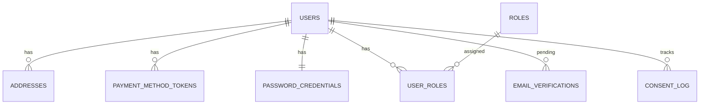

### 9.2 `products_db` — Product Service

```sql
-- =====================================================================
-- PRODUCTS DB  (NO QUANTITY, NO PRICE — those live elsewhere)
-- =====================================================================
CREATE TABLE categories (
    id          BIGSERIAL PRIMARY KEY,
    parent_id   BIGINT REFERENCES categories(id),
    slug        VARCHAR(120) NOT NULL UNIQUE,
    name        VARCHAR(160) NOT NULL,
    path        LTREE NOT NULL,                  -- '/electronics/mobiles/smartphones'
    is_active   BOOLEAN NOT NULL DEFAULT TRUE,
    version     BIGINT  NOT NULL DEFAULT 0,
    created_at  TIMESTAMPTZ NOT NULL DEFAULT now(),
    updated_at  TIMESTAMPTZ NOT NULL DEFAULT now()
);
CREATE INDEX idx_categories_path_gist ON categories USING GIST (path);
CREATE INDEX idx_categories_parent ON categories (parent_id);

CREATE TABLE brands (
    id          BIGSERIAL PRIMARY KEY,
    slug        VARCHAR(120) NOT NULL UNIQUE,
    name        VARCHAR(160) NOT NULL,
    is_active   BOOLEAN NOT NULL DEFAULT TRUE,
    created_at  TIMESTAMPTZ NOT NULL DEFAULT now()
);

CREATE TABLE products (
    id              UUID PRIMARY KEY DEFAULT gen_random_uuid(),
    sku             VARCHAR(64) NOT NULL,            -- platform-internal SKU
    gtin            VARCHAR(20),                     -- EAN/UPC/ISBN
    title           VARCHAR(500) NOT NULL,
    description     TEXT,
    brand_id        BIGINT REFERENCES brands(id),
    category_id     BIGINT NOT NULL REFERENCES categories(id),
    attributes      JSONB NOT NULL DEFAULT '{}'::JSONB,   -- color, size, weight, ...
    media_root      VARCHAR(500),                    -- S3 prefix
    status          VARCHAR(20) NOT NULL DEFAULT 'DRAFT'
                    CHECK (status IN ('DRAFT','ACTIVE','HIDDEN','DELISTED')),
    weight_grams    INT,
    dim_l_mm        INT, dim_w_mm INT, dim_h_mm INT,
    is_hazardous    BOOLEAN NOT NULL DEFAULT FALSE,
    version         BIGINT NOT NULL DEFAULT 0,
    created_at      TIMESTAMPTZ NOT NULL DEFAULT now(),
    updated_at      TIMESTAMPTZ NOT NULL DEFAULT now(),
    deleted_at      TIMESTAMPTZ
);
CREATE UNIQUE INDEX uq_products_sku ON products (sku) WHERE deleted_at IS NULL;
CREATE UNIQUE INDEX uq_products_gtin ON products (gtin) WHERE gtin IS NOT NULL;
CREATE INDEX idx_products_category ON products (category_id) WHERE status = 'ACTIVE';
CREATE INDEX idx_products_brand    ON products (brand_id)    WHERE status = 'ACTIVE';
CREATE INDEX idx_products_attrs_gin ON products USING GIN (attributes);

CREATE TABLE product_media (
    id          BIGSERIAL PRIMARY KEY,
    product_id  UUID NOT NULL REFERENCES products(id) ON DELETE CASCADE,
    kind        VARCHAR(20) NOT NULL CHECK (kind IN ('IMAGE','VIDEO','DOCUMENT')),
    url         VARCHAR(1000) NOT NULL,
    sort_order  INT NOT NULL DEFAULT 0,
    alt_text    VARCHAR(255),
    created_at  TIMESTAMPTZ NOT NULL DEFAULT now()
);
CREATE INDEX idx_product_media_pid ON product_media (product_id, sort_order);

CREATE TABLE category_attributes (
    category_id BIGINT NOT NULL REFERENCES categories(id) ON DELETE CASCADE,
    attr_key    VARCHAR(60) NOT NULL,
    data_type   VARCHAR(20) NOT NULL CHECK (data_type IN ('STRING','NUMBER','BOOL','ENUM')),
    is_required BOOLEAN NOT NULL DEFAULT FALSE,
    is_facet    BOOLEAN NOT NULL DEFAULT FALSE,
    enum_values JSONB,
    PRIMARY KEY (category_id, attr_key)
);

CREATE TABLE product_outbox (
    id          BIGSERIAL PRIMARY KEY,
    aggregate_id UUID NOT NULL,
    event_type   VARCHAR(60) NOT NULL,
    payload      JSONB NOT NULL,
    status       VARCHAR(20) NOT NULL DEFAULT 'PENDING',
    created_at   TIMESTAMPTZ NOT NULL DEFAULT now(),
    sent_at      TIMESTAMPTZ
);
CREATE INDEX idx_prod_outbox_pending ON product_outbox (status, created_at) WHERE status = 'PENDING';
```

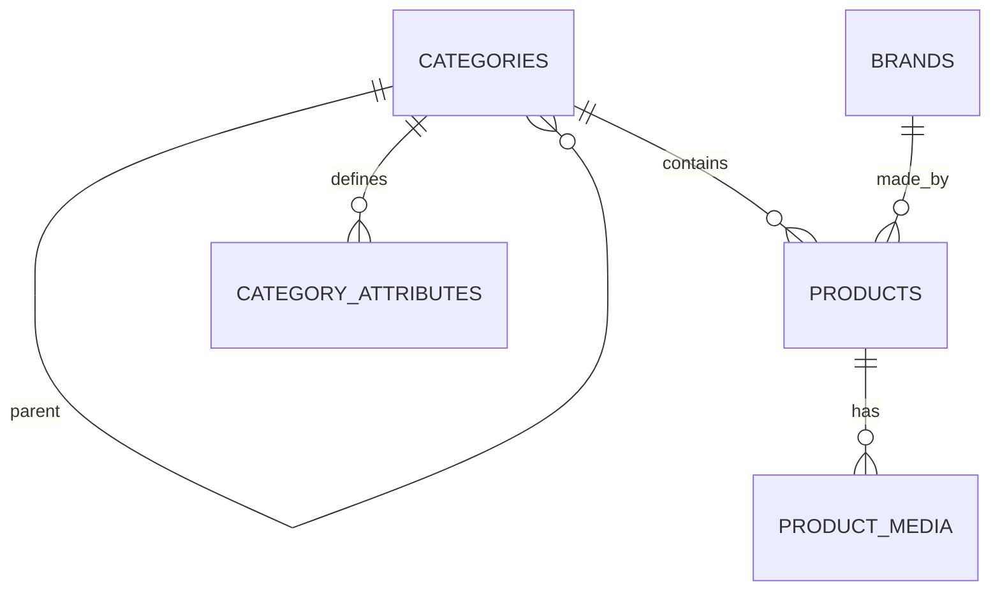

### 9.3 `suppliers_db` — Supplier Service (incl. the critical bridge)

```sql
-- =====================================================================
-- SUPPLIERS DB
-- =====================================================================
CREATE TABLE suppliers (
    id                UUID PRIMARY KEY DEFAULT gen_random_uuid(),
    legal_name        VARCHAR(255) NOT NULL,
    display_name      VARCHAR(160) NOT NULL,
    email             VARCHAR(255) NOT NULL UNIQUE,
    phone             VARCHAR(20),
    tax_id            VARCHAR(40),                    -- GSTIN, VAT, EIN
    country           CHAR(2) NOT NULL,
    onboarding_status VARCHAR(30) NOT NULL DEFAULT 'PENDING'
                      CHECK (onboarding_status IN ('PENDING','KYC_SUBMITTED','APPROVED','REJECTED','SUSPENDED')),
    rating            NUMERIC(3,2) DEFAULT 0.00,
    commission_pct    NUMERIC(5,2) NOT NULL DEFAULT 10.00,
    version           BIGINT NOT NULL DEFAULT 0,
    created_at        TIMESTAMPTZ NOT NULL DEFAULT now(),
    updated_at        TIMESTAMPTZ NOT NULL DEFAULT now()
);
CREATE INDEX idx_suppliers_status ON suppliers (onboarding_status);

CREATE TABLE supplier_kyc (
    supplier_id   UUID PRIMARY KEY REFERENCES suppliers(id) ON DELETE CASCADE,
    document_kind VARCHAR(40) NOT NULL,
    document_url  VARCHAR(1000) NOT NULL,             -- S3
    verified_at   TIMESTAMPTZ,
    verifier_ref  VARCHAR(120),                       -- external KYC provider id
    rejection_reason TEXT
);

CREATE TABLE supplier_bank_accounts (
    id           UUID PRIMARY KEY DEFAULT gen_random_uuid(),
    supplier_id  UUID NOT NULL REFERENCES suppliers(id) ON DELETE CASCADE,
    account_holder VARCHAR(160) NOT NULL,
    account_number_enc BYTEA NOT NULL,                -- KMS-encrypted
    routing_code VARCHAR(40),
    bank_name    VARCHAR(120),
    is_primary   BOOLEAN NOT NULL DEFAULT TRUE,
    verified_at  TIMESTAMPTZ,
    created_at   TIMESTAMPTZ NOT NULL DEFAULT now()
);
CREATE INDEX idx_supplier_bank ON supplier_bank_accounts (supplier_id);

CREATE TABLE supplier_warehouses (
    id              UUID PRIMARY KEY DEFAULT gen_random_uuid(),
    supplier_id     UUID NOT NULL REFERENCES suppliers(id) ON DELETE CASCADE,
    name            VARCHAR(120) NOT NULL,
    code            VARCHAR(40)  NOT NULL,            -- BLR-01
    address_line1   VARCHAR(200) NOT NULL,
    address_line2   VARCHAR(200),
    city            VARCHAR(100) NOT NULL,
    state           VARCHAR(100) NOT NULL,
    postal_code     VARCHAR(20)  NOT NULL,
    country         CHAR(2)      NOT NULL,
    geo_lat         NUMERIC(9,6),
    geo_lng         NUMERIC(9,6),
    is_active       BOOLEAN NOT NULL DEFAULT TRUE,
    created_at      TIMESTAMPTZ NOT NULL DEFAULT now(),
    UNIQUE (supplier_id, code)
);

-- ===== THE BRIDGE: one row per (supplier, product) offer =====
CREATE TABLE supplier_products (
    id             UUID PRIMARY KEY DEFAULT gen_random_uuid(),
    supplier_id    UUID NOT NULL REFERENCES suppliers(id) ON DELETE RESTRICT,
    product_id     UUID NOT NULL,                     -- ref to Product Service (no FK across DBs)
    supplier_sku   VARCHAR(80) NOT NULL,              -- supplier's internal SKU
    price          NUMERIC(19,4) NOT NULL CHECK (price > 0),
    currency       CHAR(3) NOT NULL DEFAULT 'INR',
    condition      VARCHAR(20) NOT NULL DEFAULT 'NEW'
                   CHECK (condition IN ('NEW','REFURBISHED','USED_LIKE_NEW','USED_GOOD')),
    handling_days  SMALLINT NOT NULL DEFAULT 1,
    is_active      BOOLEAN  NOT NULL DEFAULT TRUE,
    listed_at      TIMESTAMPTZ NOT NULL DEFAULT now(),
    version        BIGINT NOT NULL DEFAULT 0,
    created_at     TIMESTAMPTZ NOT NULL DEFAULT now(),
    updated_at     TIMESTAMPTZ NOT NULL DEFAULT now()
);
CREATE UNIQUE INDEX uq_supplier_product ON supplier_products (supplier_id, product_id);
CREATE INDEX idx_sp_product   ON supplier_products (product_id) WHERE is_active = TRUE;
CREATE INDEX idx_sp_supplier  ON supplier_products (supplier_id);
CREATE INDEX idx_sp_price     ON supplier_products (product_id, price) WHERE is_active = TRUE;

CREATE TABLE supplier_payout_schedules (
    supplier_id  UUID PRIMARY KEY REFERENCES suppliers(id) ON DELETE CASCADE,
    frequency    VARCHAR(20) NOT NULL DEFAULT 'WEEKLY',
    next_payout_at TIMESTAMPTZ
);

CREATE TABLE supplier_outbox (
    id          BIGSERIAL PRIMARY KEY,
    aggregate_id UUID NOT NULL,
    event_type   VARCHAR(60) NOT NULL,
    payload      JSONB NOT NULL,
    status       VARCHAR(20) NOT NULL DEFAULT 'PENDING',
    created_at   TIMESTAMPTZ NOT NULL DEFAULT now(),
    sent_at      TIMESTAMPTZ
);
CREATE INDEX idx_sup_outbox_pending ON supplier_outbox (status, created_at) WHERE status = 'PENDING';
```

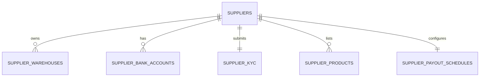

### 9.4 `inventory_db` — Inventory Service

```sql
-- =====================================================================
-- INVENTORY DB  (SOURCE OF TRUTH FOR STOCK)
-- =====================================================================
CREATE TABLE warehouses (
    id           UUID PRIMARY KEY DEFAULT gen_random_uuid(),
    supplier_id  UUID NOT NULL,                       -- ref to Supplier Service
    code         VARCHAR(40) NOT NULL,
    name         VARCHAR(120) NOT NULL,
    country      CHAR(2) NOT NULL,
    region       VARCHAR(60),
    is_active    BOOLEAN NOT NULL DEFAULT TRUE,
    created_at   TIMESTAMPTZ NOT NULL DEFAULT now(),
    UNIQUE (supplier_id, code)
);
CREATE INDEX idx_wh_supplier ON warehouses (supplier_id);

-- one row PER (supplier_product, warehouse)
CREATE TABLE inventory (
    id                  UUID PRIMARY KEY DEFAULT gen_random_uuid(),
    supplier_product_id UUID NOT NULL,                -- ref to Supplier Service
    warehouse_id        UUID NOT NULL REFERENCES warehouses(id),
    quantity_on_hand    INT  NOT NULL CHECK (quantity_on_hand >= 0),
    quantity_reserved   INT  NOT NULL DEFAULT 0 CHECK (quantity_reserved >= 0),
    safety_stock        INT  NOT NULL DEFAULT 0,
    reorder_point       INT  NOT NULL DEFAULT 0,
    last_restocked_at   TIMESTAMPTZ,
    version             BIGINT NOT NULL DEFAULT 0,    -- optimistic lock
    created_at          TIMESTAMPTZ NOT NULL DEFAULT now(),
    updated_at          TIMESTAMPTZ NOT NULL DEFAULT now(),
    CONSTRAINT chk_qty_reserved_le_onhand CHECK (quantity_reserved <= quantity_on_hand),
    UNIQUE (supplier_product_id, warehouse_id)
);
-- "available_qty" is derived: quantity_on_hand - quantity_reserved
CREATE INDEX idx_inv_supplier_product ON inventory (supplier_product_id);
CREATE INDEX idx_inv_low_stock ON inventory (supplier_product_id) WHERE (quantity_on_hand - quantity_reserved) <= safety_stock;

CREATE TABLE stock_reservations (
    id                  UUID PRIMARY KEY DEFAULT gen_random_uuid(),
    order_id            UUID NOT NULL,
    order_item_id       UUID NOT NULL,
    inventory_id        UUID NOT NULL REFERENCES inventory(id),
    supplier_product_id UUID NOT NULL,
    warehouse_id        UUID NOT NULL,
    quantity            INT  NOT NULL CHECK (quantity > 0),
    status              VARCHAR(20) NOT NULL DEFAULT 'HELD'
                        CHECK (status IN ('HELD','RELEASED','COMMITTED','EXPIRED')),
    expires_at          TIMESTAMPTZ NOT NULL,
    committed_at        TIMESTAMPTZ,
    released_at         TIMESTAMPTZ,
    idempotency_key     VARCHAR(80) NOT NULL,
    version             BIGINT NOT NULL DEFAULT 0,
    created_at          TIMESTAMPTZ NOT NULL DEFAULT now(),
    UNIQUE (idempotency_key)
);
CREATE INDEX idx_resv_order        ON stock_reservations (order_id);
CREATE INDEX idx_resv_status_exp   ON stock_reservations (status, expires_at);
CREATE INDEX idx_resv_inv          ON stock_reservations (inventory_id) WHERE status = 'HELD';

CREATE TABLE inventory_ledger (
    id                  BIGSERIAL PRIMARY KEY,
    inventory_id        UUID NOT NULL REFERENCES inventory(id),
    change_type         VARCHAR(30) NOT NULL
                        CHECK (change_type IN ('RESTOCK','RESERVE','RELEASE','DEDUCT','ADJUSTMENT_PLUS','ADJUSTMENT_MINUS','RETURN')),
    quantity_delta      INT NOT NULL,
    quantity_after      INT NOT NULL,
    reservation_id      UUID,
    reference_type      VARCHAR(30),                   -- ORDER, RETURN, MANUAL...
    reference_id        VARCHAR(80),
    actor               VARCHAR(80),
    note                TEXT,
    created_at          TIMESTAMPTZ NOT NULL DEFAULT now()
);
CREATE INDEX idx_ledger_inv_time ON inventory_ledger (inventory_id, created_at DESC);

CREATE TABLE inventory_outbox (
    id          BIGSERIAL PRIMARY KEY,
    aggregate_id UUID NOT NULL,
    event_type   VARCHAR(60) NOT NULL,
    payload      JSONB NOT NULL,
    status       VARCHAR(20) NOT NULL DEFAULT 'PENDING',
    created_at   TIMESTAMPTZ NOT NULL DEFAULT now(),
    sent_at      TIMESTAMPTZ
);
CREATE INDEX idx_inv_outbox_pending ON inventory_outbox (status, created_at) WHERE status = 'PENDING';
```

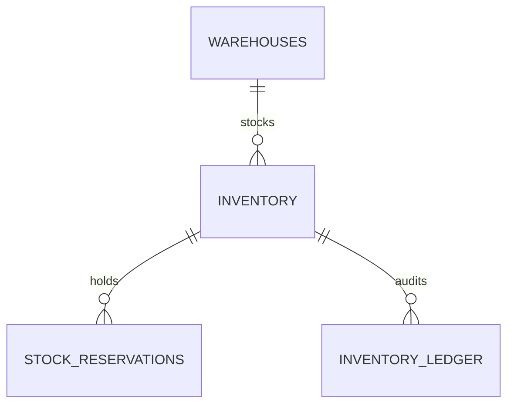

### 9.5 `orders_db` — Order Service

```sql
-- =====================================================================
-- ORDERS DB
-- =====================================================================
CREATE TABLE orders (
    id                UUID PRIMARY KEY DEFAULT gen_random_uuid(),
    order_number      VARCHAR(20) NOT NULL UNIQUE,    -- human readable
    customer_id       UUID NOT NULL,
    status            VARCHAR(30) NOT NULL DEFAULT 'CREATED'
                      CHECK (status IN ('CREATED','PAYMENT_PENDING','CONFIRMED','PARTIALLY_SHIPPED','SHIPPED','DELIVERED','CANCELLED','RETURNED','FAILED')),
    currency          CHAR(3) NOT NULL DEFAULT 'INR',
    subtotal          NUMERIC(19,4) NOT NULL,
    discount          NUMERIC(19,4) NOT NULL DEFAULT 0,
    shipping_fee      NUMERIC(19,4) NOT NULL DEFAULT 0,
    tax               NUMERIC(19,4) NOT NULL DEFAULT 0,
    total             NUMERIC(19,4) NOT NULL,
    coupon_code       VARCHAR(40),
    shipping_address  JSONB NOT NULL,                 -- snapshot
    billing_address   JSONB,
    payment_intent_id UUID,                           -- ref to Payment Service
    idempotency_key   VARCHAR(80) NOT NULL,
    placed_at         TIMESTAMPTZ NOT NULL DEFAULT now(),
    confirmed_at      TIMESTAMPTZ,
    cancelled_at      TIMESTAMPTZ,
    cancel_reason     VARCHAR(200),
    version           BIGINT NOT NULL DEFAULT 0,
    created_at        TIMESTAMPTZ NOT NULL DEFAULT now(),
    updated_at        TIMESTAMPTZ NOT NULL DEFAULT now(),
    UNIQUE (idempotency_key, customer_id)
) PARTITION BY RANGE (placed_at);

-- monthly partitions (created via job)
CREATE TABLE orders_2026_01 PARTITION OF orders FOR VALUES FROM ('2026-01-01') TO ('2026-02-01');
-- ...

CREATE INDEX idx_orders_customer_status ON orders (customer_id, status, placed_at DESC);
CREATE INDEX idx_orders_status_placed   ON orders (status, placed_at);

CREATE TABLE order_items (
    id                  UUID PRIMARY KEY DEFAULT gen_random_uuid(),
    order_id            UUID NOT NULL,                -- (no FK to partitioned parent)
    product_id          UUID NOT NULL,
    supplier_product_id UUID NOT NULL,
    supplier_id         UUID NOT NULL,
    title_snapshot      VARCHAR(500) NOT NULL,
    unit_price          NUMERIC(19,4) NOT NULL,
    quantity            INT NOT NULL CHECK (quantity > 0),
    line_total          NUMERIC(19,4) NOT NULL,
    fulfilment_status   VARCHAR(30) NOT NULL DEFAULT 'PENDING'
                        CHECK (fulfilment_status IN ('PENDING','RESERVED','PACKED','SHIPPED','DELIVERED','CANCELLED','RETURNED')),
    warehouse_id        UUID,
    reservation_id      UUID,                         -- set after Inventory reserves
    created_at          TIMESTAMPTZ NOT NULL DEFAULT now()
);
CREATE INDEX idx_oi_order    ON order_items (order_id);
CREATE INDEX idx_oi_supplier ON order_items (supplier_id, fulfilment_status);

CREATE TABLE order_status_history (
    id          BIGSERIAL PRIMARY KEY,
    order_id    UUID NOT NULL,
    from_status VARCHAR(30),
    to_status   VARCHAR(30) NOT NULL,
    reason      VARCHAR(200),
    actor       VARCHAR(80),
    created_at  TIMESTAMPTZ NOT NULL DEFAULT now()
);
CREATE INDEX idx_osh_order_time ON order_status_history (order_id, created_at DESC);

CREATE TABLE shipments (
    id              UUID PRIMARY KEY DEFAULT gen_random_uuid(),
    order_id        UUID NOT NULL,
    supplier_id     UUID NOT NULL,
    carrier         VARCHAR(60),
    tracking_number VARCHAR(100),
    status          VARCHAR(30) NOT NULL DEFAULT 'CREATED',
    shipped_at      TIMESTAMPTZ,
    delivered_at    TIMESTAMPTZ,
    created_at      TIMESTAMPTZ NOT NULL DEFAULT now()
);
CREATE INDEX idx_ship_order ON shipments (order_id);

CREATE TABLE returns (
    id           UUID PRIMARY KEY DEFAULT gen_random_uuid(),
    order_id     UUID NOT NULL,
    order_item_id UUID NOT NULL,
    reason       VARCHAR(120) NOT NULL,
    status       VARCHAR(30) NOT NULL DEFAULT 'REQUESTED',
    refund_id    UUID,
    created_at   TIMESTAMPTZ NOT NULL DEFAULT now(),
    updated_at   TIMESTAMPTZ NOT NULL DEFAULT now()
);

CREATE TABLE saga_state (
    saga_id        UUID PRIMARY KEY,
    saga_type      VARCHAR(40) NOT NULL,              -- CHECKOUT
    order_id       UUID NOT NULL,
    current_step   VARCHAR(60) NOT NULL,
    state          VARCHAR(20) NOT NULL,              -- RUNNING|COMPLETED|COMPENSATING|FAILED
    payload        JSONB NOT NULL,
    last_event_at  TIMESTAMPTZ NOT NULL DEFAULT now(),
    version        BIGINT NOT NULL DEFAULT 0
);
CREATE INDEX idx_saga_state_running ON saga_state (state, last_event_at) WHERE state = 'RUNNING';

CREATE TABLE order_outbox (
    id          BIGSERIAL PRIMARY KEY,
    aggregate_id UUID NOT NULL,
    event_type   VARCHAR(60) NOT NULL,
    payload      JSONB NOT NULL,
    status       VARCHAR(20) NOT NULL DEFAULT 'PENDING',
    created_at   TIMESTAMPTZ NOT NULL DEFAULT now(),
    sent_at      TIMESTAMPTZ
);
CREATE INDEX idx_order_outbox_pending ON order_outbox (status, created_at) WHERE status = 'PENDING';

CREATE TABLE inbox_events (
    event_id    UUID PRIMARY KEY,                    -- de-dup key from Kafka header
    consumer    VARCHAR(60) NOT NULL,
    received_at TIMESTAMPTZ NOT NULL DEFAULT now()
);
```

### 9.6 `payments_db` — Payment Service

```sql
-- =====================================================================
-- PAYMENTS DB
-- =====================================================================
CREATE TABLE payment_intents (
    id                 UUID PRIMARY KEY DEFAULT gen_random_uuid(),
    order_id           UUID NOT NULL,
    customer_id        UUID NOT NULL,
    amount             NUMERIC(19,4) NOT NULL,
    currency           CHAR(3) NOT NULL,
    provider           VARCHAR(20) NOT NULL,         -- STRIPE | RAZORPAY
    provider_intent_id VARCHAR(120),                 -- pi_xxx
    status             VARCHAR(30) NOT NULL DEFAULT 'INITIATED'
                       CHECK (status IN ('INITIATED','REQUIRES_ACTION','AUTHORIZED','CAPTURED','FAILED','CANCELLED','REFUNDED','PARTIALLY_REFUNDED')),
    idempotency_key    VARCHAR(80) NOT NULL,
    failure_code       VARCHAR(60),
    failure_message    VARCHAR(500),
    version            BIGINT NOT NULL DEFAULT 0,
    created_at         TIMESTAMPTZ NOT NULL DEFAULT now(),
    updated_at         TIMESTAMPTZ NOT NULL DEFAULT now(),
    UNIQUE (idempotency_key),
    UNIQUE (provider, provider_intent_id)
);
CREATE INDEX idx_pi_order ON payment_intents (order_id);
CREATE INDEX idx_pi_customer ON payment_intents (customer_id, created_at DESC);

CREATE TABLE payment_attempts (
    id              UUID PRIMARY KEY DEFAULT gen_random_uuid(),
    intent_id       UUID NOT NULL REFERENCES payment_intents(id) ON DELETE CASCADE,
    attempt_no      INT NOT NULL,
    provider_charge_id VARCHAR(120),
    status          VARCHAR(30) NOT NULL,
    raw_response    JSONB,
    created_at      TIMESTAMPTZ NOT NULL DEFAULT now(),
    UNIQUE (intent_id, attempt_no)
);

CREATE TABLE refunds (
    id                UUID PRIMARY KEY DEFAULT gen_random_uuid(),
    intent_id         UUID NOT NULL REFERENCES payment_intents(id),
    order_id          UUID NOT NULL,
    amount            NUMERIC(19,4) NOT NULL,
    currency          CHAR(3) NOT NULL,
    reason            VARCHAR(200),
    status            VARCHAR(30) NOT NULL DEFAULT 'INITIATED'
                      CHECK (status IN ('INITIATED','PROCESSING','SUCCESS','FAILED')),
    provider_refund_id VARCHAR(120),
    idempotency_key   VARCHAR(80) NOT NULL UNIQUE,
    version           BIGINT NOT NULL DEFAULT 0,
    created_at        TIMESTAMPTZ NOT NULL DEFAULT now(),
    completed_at      TIMESTAMPTZ
);
CREATE INDEX idx_refund_order ON refunds (order_id);

CREATE TABLE webhook_events (
    id              UUID PRIMARY KEY DEFAULT gen_random_uuid(),
    provider        VARCHAR(20) NOT NULL,
    provider_event_id VARCHAR(120) NOT NULL,
    event_type      VARCHAR(60) NOT NULL,
    payload         JSONB NOT NULL,
    signature_valid BOOLEAN NOT NULL,
    processed_at    TIMESTAMPTZ,
    received_at     TIMESTAMPTZ NOT NULL DEFAULT now(),
    UNIQUE (provider, provider_event_id)
);

CREATE TABLE payouts (
    id          UUID PRIMARY KEY DEFAULT gen_random_uuid(),
    supplier_id UUID NOT NULL,
    period_start DATE NOT NULL,
    period_end   DATE NOT NULL,
    gross_amount NUMERIC(19,4) NOT NULL,
    commission   NUMERIC(19,4) NOT NULL,
    net_amount   NUMERIC(19,4) NOT NULL,
    status       VARCHAR(30) NOT NULL DEFAULT 'PENDING',
    payout_ref   VARCHAR(120),
    created_at   TIMESTAMPTZ NOT NULL DEFAULT now()
);

CREATE TABLE payment_outbox (
    id          BIGSERIAL PRIMARY KEY,
    aggregate_id UUID NOT NULL,
    event_type   VARCHAR(60) NOT NULL,
    payload      JSONB NOT NULL,
    status       VARCHAR(20) NOT NULL DEFAULT 'PENDING',
    created_at   TIMESTAMPTZ NOT NULL DEFAULT now(),
    sent_at      TIMESTAMPTZ
);
CREATE INDEX idx_pay_outbox_pending ON payment_outbox (status, created_at) WHERE status = 'PENDING';
```

### 9.7 `notif_db` — Notification Service

```sql
-- =====================================================================
-- NOTIFICATION DB
-- =====================================================================
CREATE TABLE notification_templates (
    id        BIGSERIAL PRIMARY KEY,
    code      VARCHAR(80) NOT NULL UNIQUE,    -- ORDER_CONFIRMED_EMAIL
    channel   VARCHAR(20) NOT NULL CHECK (channel IN ('EMAIL','SMS','PUSH','IN_APP')),
    locale    VARCHAR(10) NOT NULL,
    subject   VARCHAR(255),
    body      TEXT NOT NULL,                  -- Mustache/Handlebars
    version   BIGINT NOT NULL DEFAULT 0,
    updated_at TIMESTAMPTZ NOT NULL DEFAULT now()
);

CREATE TABLE user_preferences (
    user_id   UUID PRIMARY KEY,
    email_optin BOOLEAN NOT NULL DEFAULT TRUE,
    sms_optin   BOOLEAN NOT NULL DEFAULT TRUE,
    push_optin  BOOLEAN NOT NULL DEFAULT TRUE,
    updated_at  TIMESTAMPTZ NOT NULL DEFAULT now()
);

CREATE TABLE notification_log (
    id            UUID PRIMARY KEY DEFAULT gen_random_uuid(),
    user_id       UUID NOT NULL,
    channel       VARCHAR(20) NOT NULL,
    template_code VARCHAR(80) NOT NULL,
    payload       JSONB,
    provider      VARCHAR(40),
    provider_msg_id VARCHAR(120),
    status        VARCHAR(20) NOT NULL DEFAULT 'QUEUED'
                  CHECK (status IN ('QUEUED','SENT','DELIVERED','BOUNCED','FAILED','SUPPRESSED')),
    attempt_no    INT NOT NULL DEFAULT 0,
    last_error    VARCHAR(500),
    correlation_id UUID,
    created_at    TIMESTAMPTZ NOT NULL DEFAULT now(),
    sent_at       TIMESTAMPTZ
) PARTITION BY RANGE (created_at);
CREATE INDEX idx_nl_user_time ON notification_log (user_id, created_at DESC);

CREATE TABLE suppression_list (
    address VARCHAR(255) PRIMARY KEY,
    reason  VARCHAR(60) NOT NULL,
    created_at TIMESTAMPTZ NOT NULL DEFAULT now()
);
```


### 9.8 Database Ownership Diagram

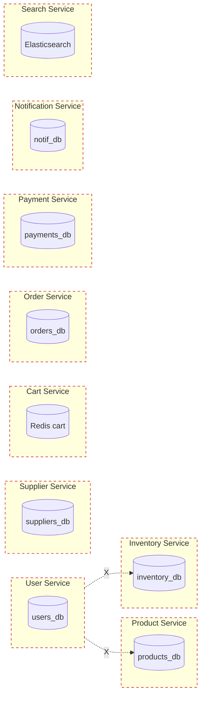

> **Each service can ONLY access its own database.** All cross-service data flows through APIs and Kafka events.

### 9.9 Combined Logical ER (cross-service id references shown dashed)

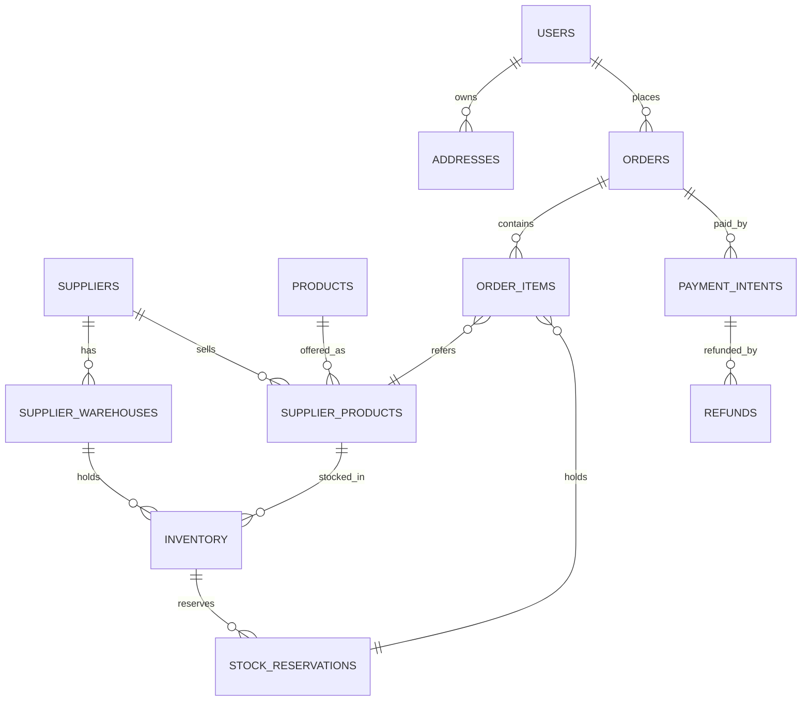

> Note: cross-DB relations are **id references**, not enforced FKs. Referential integrity is upheld by the originating service and validated at integration time.

---

## 10. Inventory Architecture — Deep Dive

Inventory is the system's single hardest correctness problem. The next several sub-sections explain *why* the design splits Product from Inventory, and *how* concurrent orders avoid oversell.

### 10.1 Why Product Service must NOT store quantity

1. **Different cardinality.** One `product_id` ↔ N `(supplier, warehouse)` rows. A scalar column cannot represent this fan-out.
2. **Different write velocity.** Catalog edits are slow (curation, taxonomy). Inventory ticks every single sale. Putting both in one table mixes hot and cold workloads; vacuum, replication lag, and index bloat patterns conflict.
3. **Different consistency.** Catalog reads tolerate ~minute staleness via cache. Inventory must be near-real-time and atomic.
4. **Different team & SLA.** Catalog team owns merchandising; Inventory team owns fulfilment correctness.
5. **Different scaling.** Inventory must shard by supplier_product; Product is fine as a single cluster.
6. **Auditability.** Inventory changes need a **ledger** (every delta, every reason). Catalog doesn't.
7. **Bounded contexts (DDD).** "Description of a thing" vs. "how many we have" are different concepts, even though customers see them merged.

### 10.2 Why Inventory keys on `supplier_product_id`, not `product_id`

Because the same `product_id` (e.g., "iPhone 15 Pro 256GB") may be sold by:

- Supplier A from warehouses BLR-01 and DEL-02
- Supplier B from warehouse MUM-01
- Supplier C from warehouse HYD-01

…each at different prices, conditions, and stock levels. We need to deduct from a **specific (supplier, warehouse)** when fulfilling. Therefore:

```
inventory row = (supplier_product_id, warehouse_id, quantity_on_hand, quantity_reserved, version)
```

### 10.3 The reservation model

We use a **two-phase commit-ish** pattern, but locally within the Inventory DB only — no distributed transaction.

**Phase 1 — Reserve (during checkout, before payment)**
```
UPDATE inventory
SET quantity_reserved = quantity_reserved + :qty,
    version = version + 1
WHERE id = :inv_id
  AND version = :expected_version
  AND (quantity_on_hand - quantity_reserved) >= :qty;
```
If `rows_affected = 0` → either someone else raced us (retry up to N), or stock is insufficient (return `INSUFFICIENT_STOCK`).

A row in `stock_reservations` is created in the same transaction with `status='HELD'`, `expires_at = now() + 10 min`, and a unique `idempotency_key` (typically `orderId:orderItemId`). Inventory outbox event `INVENTORY_RESERVED` is written.

**Phase 2a — Commit (on `PAYMENT_SUCCESS`)**
```
UPDATE inventory
SET quantity_on_hand = quantity_on_hand - :qty,
    quantity_reserved = quantity_reserved - :qty,
    version = version + 1
WHERE id = :inv_id AND version = :expected_version;
```
Reservation moves to `COMMITTED`. Outbox `INVENTORY_DEDUCTED`. Ledger entry.

**Phase 2b — Release (on `PAYMENT_FAILED` / `ORDER_CANCELLED` / timeout)**
```
UPDATE inventory
SET quantity_reserved = quantity_reserved - :qty,
    version = version + 1
WHERE id = :inv_id AND version = :expected_version;
```
Reservation → `RELEASED`. Outbox `INVENTORY_RELEASED`.

### 10.4 Why optimistic locking (not `SELECT … FOR UPDATE`)

- **Throughput.** A pessimistic row-lock serialises all concurrent buyers of a hot SKU; flash sales would queue thousands of requests inside the DB.
- **Latency.** Optimistic uses a single conditional `UPDATE` — no lock held across network round-trips.
- **Predictable conflict rate.** Conflicts retried with jittered backoff. For ultra-hot SKUs (one Switch console at midnight), we add a **Redis token bucket** in front of Inventory so requests are rate-limited before touching DB.
- **Trade-off accepted.** Increased conflict retry under contention. We measure conflict rate as a SLO and shard hotter or pre-queue requests when sustained > 5%.

### 10.5 Overselling — defence in depth

| Layer | Guard |
|-------|-------|
| Application | Read available qty before showing "in stock" badge (cached, eventually consistent) |
| Cart | Periodic refresh; on render, recompute against latest projected stock |
| Checkout | Synchronous Inventory `reserve` call — only this is **authoritative** |
| DB | `CHECK (quantity_reserved <= quantity_on_hand)` and conditional UPDATE on version + sufficiency |
| Reconciliation | Nightly job compares `sum(ledger)` to `quantity_on_hand` |

### 10.6 Reservation expiry & cleanup

A scheduled job (Kubernetes `CronJob`, runs every 60 s) processes:
```sql
SELECT id, inventory_id, quantity FROM stock_reservations
WHERE status = 'HELD' AND expires_at < now()
LIMIT 1000 FOR UPDATE SKIP LOCKED;
```
For each: release stock + mark `EXPIRED` + outbox `INVENTORY_RELEASED` (with `reason=EXPIRED`). `SKIP LOCKED` lets multiple worker pods share the queue safely.

### 10.7 Inventory event flow

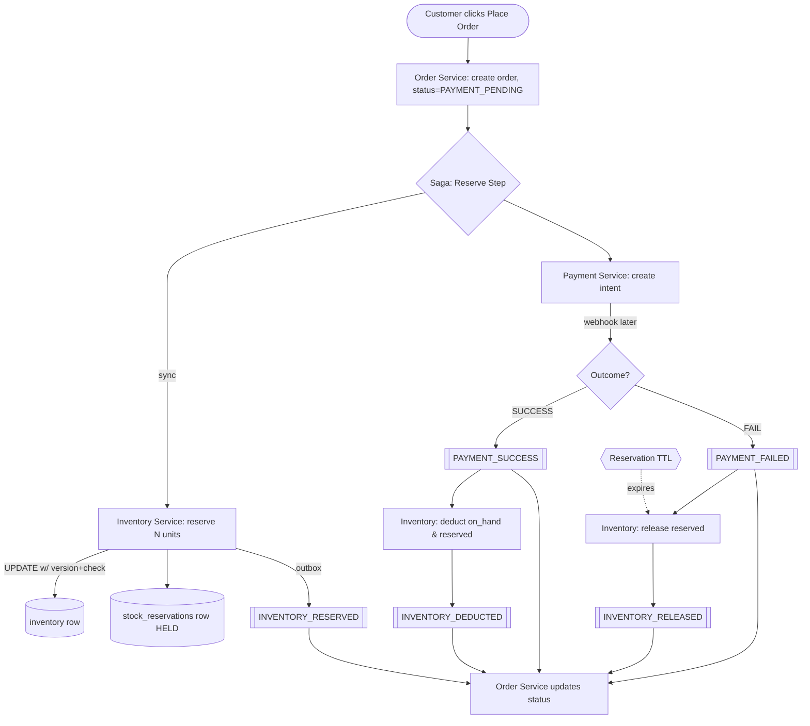

### 10.8 Hot-SKU strategy (flash sale)

For an announced flash sale on a single SKU:
1. **Pre-warm**: pre-issue N "tokens" into a Redis sorted set keyed by `flash:{supplier_product_id}`.
2. **Soft admission**: API gateway / Cart consults Redis; only token holders can proceed to `/reserve`.
3. **DB protection**: even token holders go through the same optimistic reserve path — Redis admission only smooths the curve. DB remains the authority.
4. **Per-SKU dedicated partition** on Kafka topic `inventory.events.{supplier_product_id}` to preserve causal ordering for that SKU.

### 10.9 Concurrent update — worked example

Two customers both try to buy the last 2 units when 3 are available, `version=10`.

| Step | Customer A | Customer B | DB |
|------|-----------|------------|----|
| 1 | Read inv (on_hand=3, reserved=0, v=10) |   | v=10 |
| 2 |   | Read inv (on_hand=3, reserved=0, v=10) | v=10 |
| 3 | UPDATE … SET reserved=2, v=11 WHERE v=10 AND avail≥2 → 1 row | | v=11, reserved=2 |
| 4 |   | UPDATE … WHERE v=10 → **0 rows** (version mismatch) | v=11 |
| 5 |   | Retry: re-read (on_hand=3, reserved=2, v=11), avail=1 < 2 → `INSUFFICIENT_STOCK` | — |

No oversell, no lock held, ≤ 1 retry.


---

## 11. API Specifications

### 11.1 Conventions

- All APIs are versioned: `/api/v1/...`
- Authn: `Authorization: Bearer <JWT>`; gateway validates signature against JWKS; passes claims as `X-User-Id`, `X-Roles` headers.
- Idempotency: every state-mutating POST/PUT accepts `Idempotency-Key: <uuid>` (required for orders, payments, inventory).
- Pagination: cursor-based (`?cursor=&limit=20`) for hot/large lists; offset-based (`?page=&size=`) for admin.
- Sorting: `?sort=field,asc|desc` (multiple comma-separated).
- Filtering: `?filter[field]=value` or `?field=value` (consistent per service, documented per endpoint).
- Error envelope:
```json
{ "error": { "code": "INSUFFICIENT_STOCK", "message": "...", "details": {...}, "traceId": "..." } }
```
- Standard codes: `400 VALIDATION_ERROR`, `401 UNAUTHENTICATED`, `403 FORBIDDEN`, `404 NOT_FOUND`, `409 CONFLICT`, `422 BUSINESS_RULE_VIOLATION`, `429 RATE_LIMITED`, `500 INTERNAL`, `503 UPSTREAM_UNAVAILABLE`.

### 11.2 User Service

| Method | Path | Auth | Purpose |
|--------|------|------|---------|
| POST | `/api/v1/users/register` | public | Create account |
| POST | `/api/v1/users/login` | public | Issue tokens |
| POST | `/api/v1/users/refresh` | refresh | New access token |
| POST | `/api/v1/users/logout` | bearer | Revoke refresh |
| GET | `/api/v1/users/me` | bearer | Profile |
| PATCH | `/api/v1/users/me` | bearer | Update profile |
| GET | `/api/v1/users/me/addresses` | bearer | List addresses |
| POST | `/api/v1/users/me/addresses` | bearer | Add address |
| PATCH | `/api/v1/users/me/addresses/{id}` | bearer | Update |
| DELETE | `/api/v1/users/me/addresses/{id}` | bearer | Remove |
| GET | `/api/v1/users/me/payment-methods` | bearer | List tokens |
| POST | `/api/v1/users/me/payment-methods` | bearer | Add (from PSP token) |
| POST | `/api/v1/users/password/reset-request` | public | Send reset email |
| POST | `/api/v1/users/password/reset` | one-time token | Reset |
| GET | `/api/v1/internal/users/{id}` | mTLS | Internal lookup |

**Register — request/response**
```http
POST /api/v1/users/register
Content-Type: application/json
Idempotency-Key: 9f0...

{ "email":"raghu@example.com","password":"...","firstName":"Raghu","lastName":"V","phone":"+91...","locale":"en-IN" }
```
```json
201 Created
{ "userId":"uuid","email":"...","status":"PENDING_VERIFICATION","verificationEmailSent":true }
```
Validation: email RFC5322 + DNS MX hint, password ≥ 12 chars w/ class mix, phone E.164. Async: emits `USER_REGISTERED`.

### 11.3 Product Service

| Method | Path | Auth | Purpose |
|--------|------|------|---------|
| GET | `/api/v1/products` | public | List w/ filters, sort, pagination |
| GET | `/api/v1/products/{id}` | public | Detail + active offers (joined from Supplier via cache) |
| GET | `/api/v1/categories` | public | Tree |
| GET | `/api/v1/categories/{slug}/products` | public | Browse |
| POST | `/api/v1/products` | admin | Create catalog product |
| PATCH | `/api/v1/products/{id}` | admin | Update |
| DELETE | `/api/v1/products/{id}` | admin | Soft delete |
| POST | `/api/v1/products/{id}/media` | admin | Upload (pre-signed URL flow) |
| GET | `/api/v1/internal/products/{id}` | mTLS | Internal |

**Browse — example**
```
GET /api/v1/categories/smartphones/products
   ?filter[brand]=apple&filter[storage]=256GB&priceMin=80000&priceMax=150000
   &sort=relevance,desc&cursor=eyJ...&limit=24
```
Response includes `items[]` (one entry per product with `lowestOfferPrice`, `availableFromCount`, top-2 offers preview), `pageInfo.nextCursor`, `facets[]`.

> **Note** — search/filter at scale is served by **Search Service** (Elasticsearch). Product Service serves authoritative detail. The catalog browse endpoint actually fans out to Search for filter/sort and to Product DB for canonical data — both behind the same gateway route.

### 11.4 Supplier Service

| Method | Path | Auth | Purpose |
|--------|------|------|---------|
| POST | `/api/v1/suppliers` | public→onboard | Begin onboarding |
| POST | `/api/v1/suppliers/{id}/kyc` | supplier | Submit KYC docs |
| GET | `/api/v1/suppliers/{id}` | supplier/admin | Profile |
| POST | `/api/v1/suppliers/{id}/warehouses` | supplier | Add warehouse |
| GET | `/api/v1/suppliers/{id}/warehouses` | supplier | List |
| POST | `/api/v1/suppliers/{id}/offers` | supplier | Create supplier_product |
| PATCH | `/api/v1/suppliers/{id}/offers/{offerId}` | supplier | Update price/status |
| GET | `/api/v1/suppliers/{id}/offers` | supplier | List, paginated |
| POST | `/api/v1/suppliers/{id}/offers/bulk` | supplier | CSV upload (async) |
| GET | `/api/v1/internal/offers/{id}` | mTLS | Lookup by offer id |
| GET | `/api/v1/internal/offers?productId=` | mTLS | All offers for product (used by Search) |

**Create offer (supplier_product)**
```http
POST /api/v1/suppliers/{supplierId}/offers
Authorization: Bearer <supplier-jwt>
Idempotency-Key: ...

{ "productId":"<catalog-uuid>", "supplierSku":"SUP-0042-IP15P",
  "price":129900.00, "currency":"INR", "condition":"NEW", "handlingDays":1 }
```
```json
201 { "offerId":"uuid", "isActive":true, "listedAt":"2026-..." }
```
Emits `OFFER_CREATED` → Inventory Service auto-provisions a zero-stock inventory row per supplier warehouse if `auto_provision_inventory` flag is on; otherwise supplier must call Inventory `POST /stock` next.

### 11.5 Inventory Service

| Method | Path | Auth | Purpose |
|--------|------|------|---------|
| GET | `/api/v1/inventory?supplierProductId=` | supplier/admin | View stock per warehouse |
| POST | `/api/v1/inventory/stock` | supplier | Set/adjust stock per warehouse |
| POST | `/api/v1/inventory/stock/bulk` | supplier | CSV import (async) |
| POST | `/api/v1/internal/inventory/reserve` | mTLS | (called by Order) reserve N |
| POST | `/api/v1/internal/inventory/release` | mTLS | (called by Order) release reservation |
| POST | `/api/v1/internal/inventory/deduct` | mTLS | (called by Order on PAYMENT_SUCCESS) |
| GET | `/api/v1/internal/inventory/availability?productId=` | mTLS | Aggregated availability for product page |

**Reserve (the critical call)**
```http
POST /api/v1/internal/inventory/reserve
X-Service: order-service
Idempotency-Key: order_<orderId>:item_<orderItemId>

{
  "orderId":"...",
  "items":[
    {"orderItemId":"...", "supplierProductId":"...", "warehouseHint":"BLR-01", "quantity":2}
  ],
  "ttlSeconds": 600
}
```
Behaviour:
- Picks warehouse: hint > nearest-to-buyer > most stock.
- For each item: optimistic update; on failure retry 3× with 50/100/200ms jittered backoff.
- All-or-nothing: if any item fails, **all already-reserved items in this call are released** before returning.
- Response:
```json
200 { "reservations":[{"orderItemId":"...","reservationId":"...","warehouseId":"...","expiresAt":"..."}] }
422 { "error":{"code":"INSUFFICIENT_STOCK","details":{"orderItemId":"...","available":0}} }
```

### 11.6 Cart Service

| Method | Path | Auth | Purpose |
|--------|------|------|---------|
| GET | `/api/v1/cart` | bearer | Render cart with live pricing/avail |
| POST | `/api/v1/cart/items` | bearer | Add item (productId + optional preferredSupplierId) |
| PATCH | `/api/v1/cart/items/{itemId}` | bearer | Change qty |
| DELETE | `/api/v1/cart/items/{itemId}` | bearer | Remove |
| DELETE | `/api/v1/cart` | bearer | Clear |
| POST | `/api/v1/cart/merge` | bearer | Merge guest cart on login |

Render returns: items, line totals using **current** offer price from cache, `availability` flag per line (server-side check against Inventory cache).

### 11.7 Order Service

| Method | Path | Auth | Purpose |
|--------|------|------|---------|
| POST | `/api/v1/orders` | bearer | Place order (Saga starts) |
| GET | `/api/v1/orders/{id}` | bearer | Detail |
| GET | `/api/v1/orders` | bearer | History, cursor pagination |
| POST | `/api/v1/orders/{id}/cancel` | bearer | Customer cancel (if eligible) |
| POST | `/api/v1/orders/{id}/return` | bearer | Initiate return |
| GET | `/api/v1/orders/{id}/invoice` | bearer | PDF link (pre-signed) |
| GET | `/api/v1/internal/orders/{id}` | mTLS | Internal |

**Place order**
```http
POST /api/v1/orders
Authorization: Bearer <jwt>
Idempotency-Key: <uuid v4>

{
  "cartId":"...",
  "shippingAddressId":"...",
  "billingAddressId":"...",
  "paymentMethodTokenId":"...",
  "couponCode":"SAVE10"
}
```
Response:
```json
202 Accepted
{
  "orderId":"...",
  "orderNumber":"BZ-26051200001",
  "status":"PAYMENT_PENDING",
  "amount":{"subtotal":...,"discount":...,"tax":...,"shipping":...,"total":...},
  "nextAction":{"kind":"CONFIRM_PAYMENT","clientSecret":"pi_xxx_secret_yyy"}
}
```
The `clientSecret` is forwarded from Payment Service so the client SDK completes the payment.

### 11.8 Payment Service

| Method | Path | Auth | Purpose |
|--------|------|------|---------|
| POST | `/api/v1/internal/payments/intents` | mTLS | Create intent for order |
| POST | `/api/v1/internal/payments/intents/{id}/confirm` | mTLS | Server-side confirm (optional) |
| POST | `/api/v1/internal/payments/refunds` | mTLS | Initiate refund |
| GET | `/api/v1/payments/{id}` | bearer (owner) | Status |
| POST | `/api/v1/webhooks/stripe` | signed | Stripe webhook |
| POST | `/api/v1/webhooks/razorpay` | signed | Razorpay webhook |

### 11.9 Notification Service

| Method | Path | Auth | Purpose |
|--------|------|------|---------|
| GET | `/api/v1/notifications/preferences` | bearer | Get |
| PUT | `/api/v1/notifications/preferences` | bearer | Update opt-ins |
| GET | `/api/v1/notifications` | bearer | In-app inbox |

(All sending is event-driven; no public "send" API.)

### 11.10 Search Service

| Method | Path | Auth | Purpose |
|--------|------|------|---------|
| GET | `/api/v1/search?q=&filters=` | public | Full-text + faceted |
| GET | `/api/v1/search/suggest?q=` | public | Autocomplete |

---

## 12. User Journey Flows (Sequence Diagrams)

### 12.1 User Registration

```mermaid
sequenceDiagram
    actor C as Client
    participant GW as API GW
    participant US as User Svc
    participant DB as users_db
    participant K as Kafka
    participant N as Notif Svc

    C->>GW: POST /users/register
    GW->>US: forward (rate-limited)
    US->>DB: BEGIN; INSERT user; INSERT credentials; INSERT outbox(USER_REGISTERED); COMMIT
    US-->>C: 201 { userId, status:PENDING_VERIFICATION }
    Note over US: Outbox poller
    US->>K: produce USER_REGISTERED
    K-->>N: consume
    N->>N: render WELCOME_EMAIL template
    N->>SMTP: send
```

### 12.2 Login

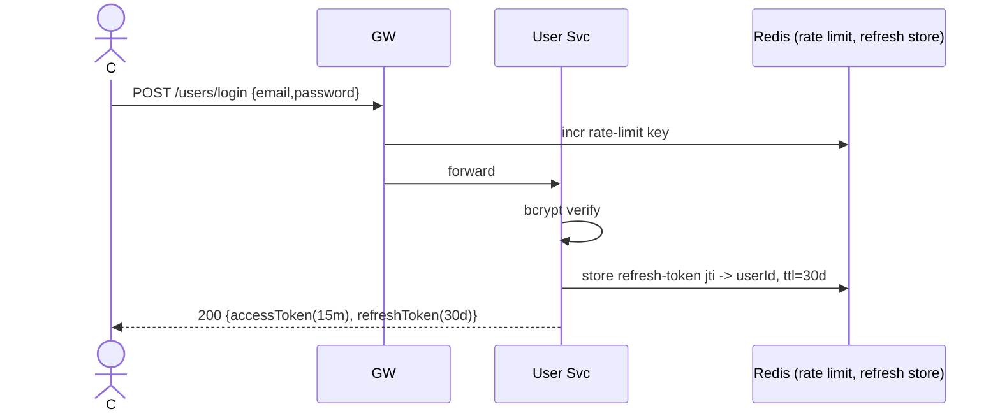

### 12.3 Product Browsing

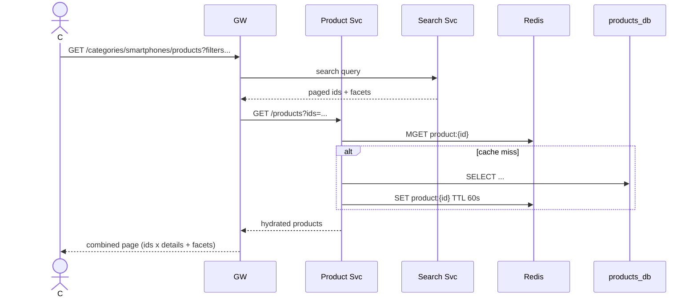

### 12.4 Product Search

Identical shape to browse — Search Service answers, Product Service hydrates only the visible page. Search Service merges live offer-min-price (incrementally updated via `OFFER_PRICE_UPDATED` events) so sort-by-price works.

### 12.5 Add to Cart

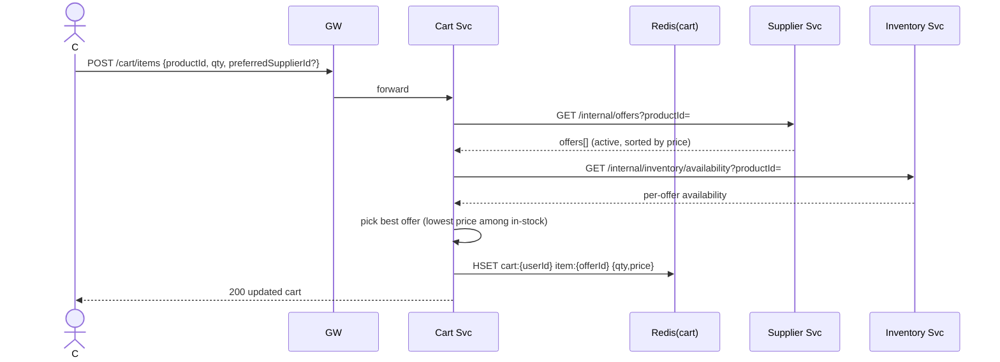

### 12.6 Checkout (the **Saga**) — full happy path

```mermaid
sequenceDiagram
    actor C
    participant GW
    participant OS as Order Svc
    participant INV as Inventory Svc
    participant PAY as Payment Svc
    participant K as Kafka
    participant N as Notif

    C->>GW: POST /orders {cartId, addr, paymentMethod}
    GW->>OS: forward (Idempotency-Key)
    OS->>OS: dedupe via idempotency_key
    OS->>OS: BEGIN; INSERT order(status=CREATED); INSERT order_items; INSERT saga_state(step=RESERVE); COMMIT
    OS->>INV: POST /reserve  (sync, mTLS)
    INV-->>OS: reservations[] OK
    OS->>OS: UPDATE order SET status=PAYMENT_PENDING; saga step=PAY
    OS->>PAY: POST /intents (amount, idem-key=order_<id>)
    PAY->>Stripe: create intent
    Stripe-->>PAY: intent + clientSecret
    PAY-->>OS: {intentId, clientSecret}
    OS-->>C: 202 {orderId, clientSecret}
    Note over C: Client SDK confirms 3DS
    Stripe-->>PAY: webhook payment_intent.succeeded
    PAY->>PAY: verify signature, persist webhook_event
    PAY->>K: PAYMENT_SUCCESS (outbox)
    K-->>OS: consume
    OS->>INV: POST /deduct (idem-key=order_<id>:deduct)
    INV-->>OS: OK
    OS->>OS: UPDATE order SET status=CONFIRMED; saga step=DONE
    OS->>K: ORDER_CONFIRMED (outbox)
    K-->>N: consume → send confirmation email + push
```

### 12.7 Inventory Reservation (zoomed)

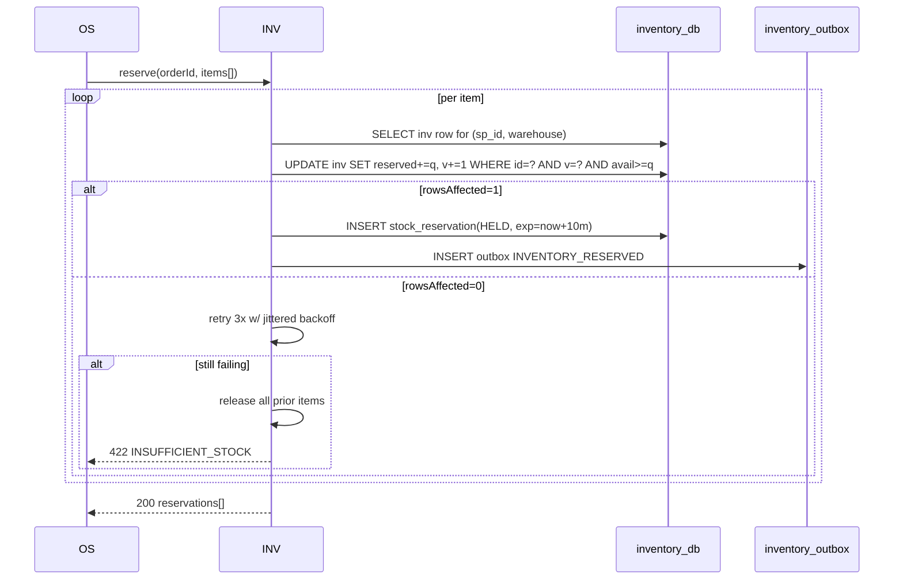

### 12.8 Payment Processing (incl. webhook)

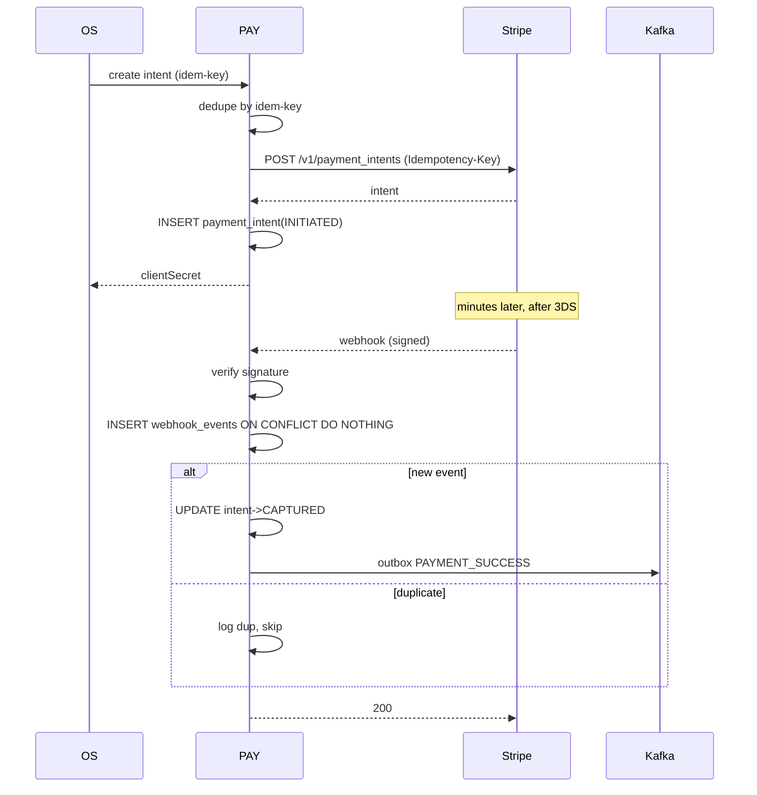

### 12.9 Order Confirmation

`ORDER_CONFIRMED` fan-out: Notification (email/SMS/push), Search (no-op), Analytics (GMV), Shipping (label creation), Supplier portal (new task).

### 12.10 Inventory Deduction

Triggered by `PAYMENT_SUCCESS`. Idempotency key = `deduct:<orderId>:<itemId>`. Updates `inventory.quantity_on_hand` and `quantity_reserved` atomically; flips reservation to `COMMITTED`; emits `INVENTORY_DEDUCTED`; writes ledger row.

### 12.11 Refund Flow

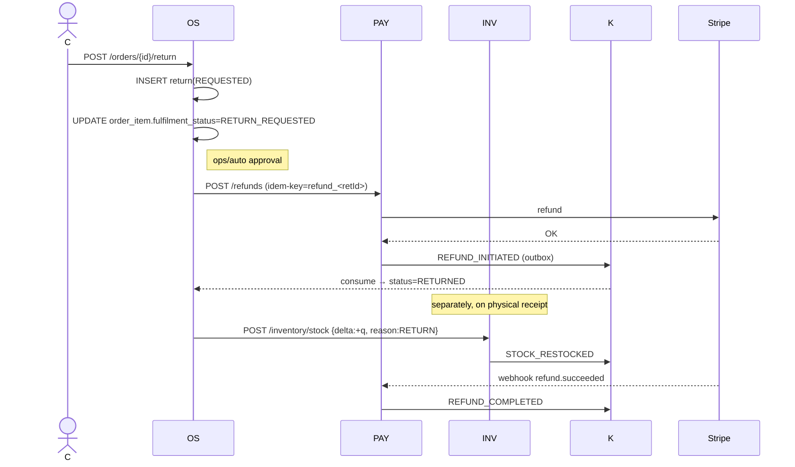

### 12.12 Order Cancellation (before shipping)

If status ∈ {CREATED, PAYMENT_PENDING}:
- If payment not captured → cancel intent at PSP → release reservation → `ORDER_CANCELLED`.
- If payment captured → initiate refund → release reservation → `ORDER_CANCELLED`.

### 12.13 Inventory Release

Triggers: `PAYMENT_FAILED`, `ORDER_CANCELLED`, reservation `EXPIRED` (cron). Idempotent via `reservation_id`. Ledger row with reason.

### 12.14 Notification Sending

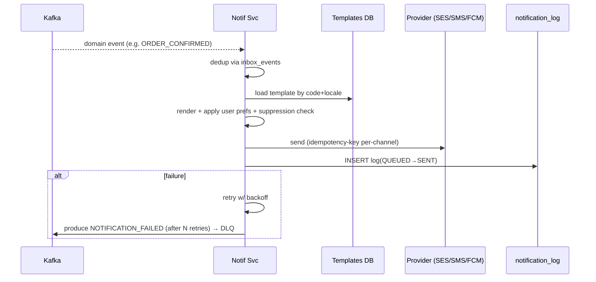


---

## 13. Event-Driven Architecture

### 13.1 Why Kafka (over RabbitMQ)

- **Replay**: consumers can rewind to any offset for backfill and reprocessing.
- **Partitioned ordering**: per-key ordering preserved (critical for inventory & order).
- **High throughput**: batches and zero-copy IO scale to hundreds of MB/s.
- **Log compaction**: keeps the latest state per key for state snapshots.
- **Durable**: replication factor ≥ 3, `min.insync.replicas=2`.

RabbitMQ remains an option for low-volume internal RPC-style fanout where ordering doesn't matter, but for the domain event spine, Kafka wins.

### 13.2 Topic taxonomy

```
domain.user.events           # USER_REGISTERED, USER_UPDATED, ...
domain.product.events
domain.supplier.events
domain.inventory.events       (partitions=64, key=supplier_product_id)
domain.cart.events
domain.order.events           (partitions=64, key=order_id)
domain.payment.events         (partitions=32, key=order_id)
domain.notification.dlq
*.dlq                        # per-topic dead-letter
```
Retention: 7 days for events, 30 days for `order.events` (audit), compacted topics for `product.state` (current state snapshot).

### 13.3 Event catalogue (selected)

**ORDER_CREATED**
```json
{
  "eventId": "uuid-v4",
  "eventType": "ORDER_CREATED",
  "occurredAt": "2026-05-12T10:00:00Z",
  "producer": "order-service",
  "version": 1,
  "traceId": "...",
  "data": {
    "orderId":"...","customerId":"...","totalAmount":12999.00,"currency":"INR",
    "items":[{"orderItemId":"...","supplierProductId":"...","quantity":2,"unitPrice":6499.00}]
  }
}
```

**INVENTORY_RESERVED**
```json
{
  "eventType":"INVENTORY_RESERVED",
  "data":{ "orderId":"...","reservations":[{"orderItemId":"...","reservationId":"...","supplierProductId":"...","warehouseId":"...","quantity":2,"expiresAt":"..."}] }
}
```

**INVENTORY_RELEASED**
```json
{ "eventType":"INVENTORY_RELEASED",
  "data":{"orderId":"...","reservationId":"...","reason":"PAYMENT_FAILED|ORDER_CANCELLED|EXPIRED"}}
```

**INVENTORY_DEDUCTED**
```json
{"eventType":"INVENTORY_DEDUCTED","data":{"orderId":"...","items":[{"reservationId":"...","supplierProductId":"...","warehouseId":"...","quantity":2}]}}
```

**PAYMENT_SUCCESS / PAYMENT_FAILED**
```json
{ "eventType":"PAYMENT_SUCCESS",
  "data":{"orderId":"...","paymentIntentId":"...","amount":12999.00,"capturedAt":"...","provider":"STRIPE"}}
```

**ORDER_CANCELLED**
```json
{ "eventType":"ORDER_CANCELLED",
  "data":{"orderId":"...","reason":"CUSTOMER_REQUEST|PAYMENT_FAILED|FRAUD","cancelledAt":"..."}}
```

**REFUND_INITIATED / REFUND_COMPLETED**
```json
{ "eventType":"REFUND_COMPLETED",
  "data":{"orderId":"...","refundId":"...","amount":12999.00,"completedAt":"..."}}
```

### 13.4 Producer / Consumer matrix

| Event | Producer | Consumers |
|-------|----------|-----------|
| USER_REGISTERED | User | Notification, Recommendation, Analytics |
| PRODUCT_CREATED/UPDATED/DELETED | Product | Search, Cart (invalidate), Analytics |
| OFFER_CREATED / OFFER_PRICE_UPDATED | Supplier | Search, Cart, Inventory (provision) |
| ORDER_CREATED | Order | Notification, Analytics, Inventory (Saga step uses sync, but event for fan-out) |
| INVENTORY_RESERVED / RELEASED / DEDUCTED | Inventory | Order, Search (availability projection), Analytics |
| PAYMENT_SUCCESS / FAILED | Payment | Order, Notification, Analytics |
| ORDER_CONFIRMED | Order | Notification, Shipping, Supplier portal, Analytics, Recommendation |
| ORDER_CANCELLED | Order | Inventory, Payment (if refundable), Notification |
| REFUND_INITIATED / COMPLETED | Payment | Order, Notification |

### 13.5 Kafka event flow (cross-service)

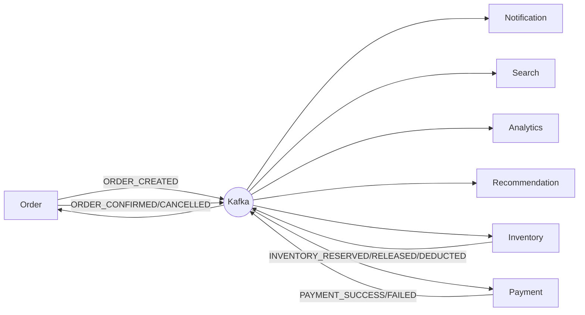

### 13.6 Idempotency

Every consumer maintains an **inbox** table:
```sql
CREATE TABLE inbox_events (
    event_id    UUID PRIMARY KEY,
    consumer    VARCHAR(60) NOT NULL,
    received_at TIMESTAMPTZ NOT NULL DEFAULT now()
);
```
On consume: `INSERT … ON CONFLICT DO NOTHING`. If `rows = 0`, the event was already processed → ack and skip. This makes "at-least-once" delivery from Kafka effectively "exactly-once" at the application level.

### 13.7 Retries & DLQ

Strategy:
1. **Local retry** with exponential backoff (50, 250, 1000 ms) for transient failures (network, DB deadlock).
2. **Retry topic** for longer waits — events moved to `topic.retry.5m`, `topic.retry.30m`, `topic.retry.2h`.
3. **DLQ** for poison messages after max attempts. Alerts page on-call. Manual replay tooling available.
4. **Circuit breaker**: if downstream is consistently failing, pause consumer (manual ops or via control event).

### 13.8 Transactional Outbox

Every producer writes the event into a service-local `..._outbox` table **in the same DB transaction** as the state change. A poller (Spring `@Scheduled` or Debezium CDC on the WAL) reads `PENDING` rows and publishes to Kafka, marking them `SENT`. Failure leaves them `PENDING` for retry. This eliminates the dual-write problem.

```java
// pseudo
@Transactional
public Order place(PlaceOrderCmd cmd) {
    var order = orders.save(new Order(...));
    items.saveAll(...);
    outbox.save(new OutboxEntry("ORDER_CREATED", payloadOf(order)));
    return order;
} // commit publishes nothing yet; poller will
```

### 13.9 Inbox (consumer-side dedupe)

Pair the outbox with an `inbox_events` table per consumer; idempotent processing as in 13.6.

---

## 14. Payment Architecture

### 14.1 Goals & constraints

- PCI-DSS SAQ-A: we never see card numbers. Tokens only, captured client-side via PSP JS SDK / Drop-in.
- Multi-provider (Stripe & Razorpay) with a uniform internal model.
- All money operations idempotent and auditable.
- Provider webhooks are the **authoritative** signal that money moved; API responses are advisory.

### 14.2 Internal model

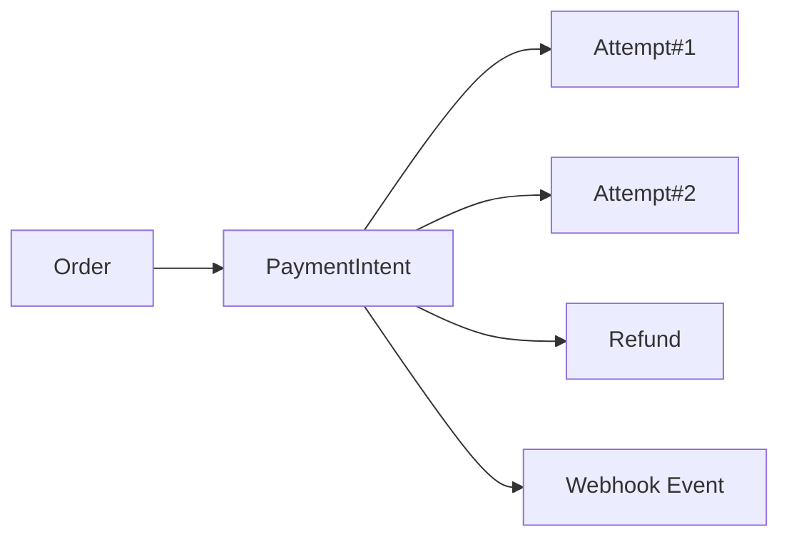

`payment_intent` is our normalised contract; `provider_intent_id` links to Stripe `pi_xxx` / Razorpay `order_xxx`.

### 14.3 Initiation flow

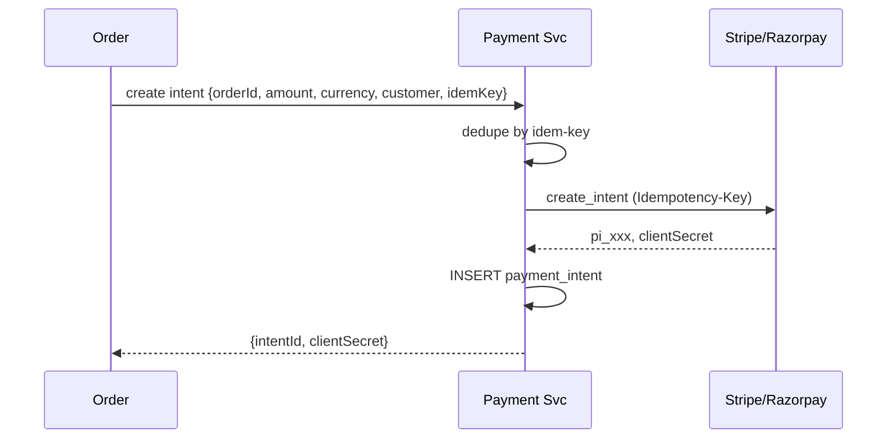

Client confirms with PSP using `clientSecret` (3DS if required).

### 14.4 Webhook handling

```java
@PostMapping("/webhooks/stripe")
public ResponseEntity<Void> stripe(@RequestHeader("Stripe-Signature") String sig,
                                   @RequestBody String body) {
    var event = stripe.verifyAndParse(body, sig); // throws if invalid
    var ins = webhookRepo.insertIfAbsent(event.id(), event.type(), body); // ON CONFLICT DO NOTHING
    if (!ins) return ResponseEntity.ok().build(); // duplicate
    paymentService.handleWebhook(event);  // updates intent, writes outbox
    return ResponseEntity.ok().build();
}
```
Endpoint must respond ≤ 5 s. We do **only signature verification + persistence**; heavy work is async. Returning 200 prevents retries.

### 14.5 Refunds

API `/internal/payments/refunds` with `idempotency_key` (e.g., `refund_<returnId>`). Calls PSP refund API with the same key. Status updates flow back through webhooks.

### 14.6 Retries & failure

- 3× exponential retry on transient PSP errors (`5xx`, network).
- Permanent declines (`card_declined`) → mark `FAILED`, emit `PAYMENT_FAILED` → Saga compensates.
- Stuck `INITIATED` intents older than 1 h → reconciliation job queries PSP for canonical status.

### 14.7 Fraud (basics)

- Velocity rules in Order Service before intent creation (orders per customer per 24h, mismatching billing/shipping geo).
- Stripe Radar / Razorpay Risk on top.
- Manual review queue for amount > threshold or new account.
- Outcome events feed back to Recommendation/User score.

### 14.8 Settlements & payouts

Daily job aggregates `payment_intents.CAPTURED` per supplier → creates `payouts` rows → triggers PSP payout (Stripe Connect / Razorpay Route).

---

## 15. Security Architecture

### 15.1 AuthN

- **OAuth2 Authorization Code + PKCE** for web/mobile.
- **JWT (RS256)** access token, lifetime 15 min. Claims: `sub`, `roles[]`, `tenantId`, `jti`, `iat`, `exp`.
- **Opaque refresh** token, 30-day lifetime, stored hashed in Redis with `jti → userId` mapping; revocable.
- **JWKS** rotated quarterly, gateway caches keys.

### 15.2 AuthZ

- **RBAC** (CUSTOMER, SUPPLIER, ADMIN, OPS) enforced at gateway (coarse) and service (fine, ownership-scoped checks).
- Method-level `@PreAuthorize("hasRole('SUPPLIER') and #supplierId == authentication.principal.supplierId")`.
- ABAC for resource ownership (customer can only see their own orders).

### 15.3 Service-to-service

- **mTLS** inside the cluster (Istio/Linkerd) — every service has a SPIFFE-like identity.
- Internal endpoints `/api/v1/internal/**` only routable from within mesh; rejected at gateway.
- Service-to-service JWTs (short-lived 60s, audience-scoped) for higher-trust calls.

### 15.4 Supplier API access

- API key + HMAC signature on every request (`X-Bz-Key`, `X-Bz-Signature`, `X-Bz-Timestamp`, replay window ±5 min).
- Per-key rate limits, IP allowlists optional, full audit log.

### 15.5 Gateway protections

- WAF (managed) with OWASP rules.
- Per-IP and per-token sliding-window rate limits (Redis).
- Bot detection on `/login`, `/register`, search query rate.
- Request size limits, MIME validation.

### 15.6 Secrets

- HashiCorp Vault / AWS Secrets Manager.
- DB credentials rotated 30-day; PSP keys 90-day.
- KMS-encrypted columns for bank account numbers, tokens, KYC docs at rest.

### 15.7 Data protection

- TLS 1.2+ everywhere (1.3 preferred).
- PII columns encrypted at rest via Postgres `pgcrypto` for tax IDs.
- Right-to-erasure (GDPR/DPDP) implemented via tombstone events that cascade to all consumers within 30 days.
- Audit log (immutable, append-only WORM bucket) for any access to PII fields.

### 15.8 Threat model summary

| Threat | Mitigation |
|--------|-----------|
| Credential stuffing | Rate limit + CAPTCHA + breached-password check |
| Order replay | Idempotency key + customer scope |
| Webhook spoofing | Signature verify + replay protection |
| Inventory race / oversell | Optimistic locking + check constraint |
| Cross-service auth bypass | mTLS + internal-only routes |
| SQL injection | Parameterised queries (JPA/JDBI) + DB user least-privilege |
| SSRF in image processing | Allowlist, dedicated egress proxy |
| Token leakage | Short TTL, revocation list, key rotation |

---

## 16. Caching Strategy

### 16.1 Tiers

1. **CDN edge** — product images, static catalog HTML pages (where applicable).
2. **Application Redis** — primary caching tier; sub-ms reads.
3. **Local caffeine cache** — only for *truly* static data (categories, currency codes), 60 s TTL, defensive copy.
4. **DB read replicas** — for analytical and heavy listing queries.

### 16.2 What we cache

| Key pattern | Source service | TTL | Invalidation |
|-------------|---------------|-----|--------------|
| `product:{id}` | Product | 60 s + event-driven | `PRODUCT_UPDATED/DELETED` evicts |
| `category:{slug}:products:page:{n}` | Search→Product | 30 s | event-driven (lazy) |
| `offers:{productId}` | Supplier | 30 s | `OFFER_*` evicts |
| `availability:{productId}` | Inventory | 5 s | `INVENTORY_*` partial update |
| `cart:{userId}` | Cart | session-bound (primary store) | — |
| `session:refresh:{jti}` | User | 30 d | logout/revoke |
| `user:{id}:profile` | User | 5 min | `USER_UPDATED` evicts |
| `ratelimit:{userId}:{route}` | Gateway | sliding window | natural expiry |
| `flash:{spId}:tokens` | Inventory | sale window | natural expiry |
| `lock:supplier_product:{id}` | Inventory | 30 s | natural expiry |

### 16.3 Patterns

- **Cache-aside (read-through)** for product detail.
- **Write-through** for cart (Redis is primary; snapshot DB is async).
- **Event-driven invalidation** — services consume domain events and `DEL` keys. This avoids stampedes that pure-TTL would cause.
- **Stampede protection** — `SETNX cache-lock:{key}` with TTL during DB refill; other callers serve stale-while-revalidate.
- **Negative caching** for "not found" (60 s) to prevent repeated DB scans for bad ids.

### 16.4 Cache-miss & failure behaviour

- If Redis is unavailable: services degrade to DB-only reads and disable some features (e.g., availability returns coarse "IN_STOCK / LOW / OUT" without warehouse breakdown).
- Inventory **never** trusts the cache for the authoritative reservation — DB is the source of truth.

---

## 17. Search Architecture

### 17.1 Indexing pipeline

```mermaid
flowchart LR
    PS[Product Svc] -- PRODUCT_* --> K((Kafka))
    SS[Supplier Svc] -- OFFER_* --> K
    INV[Inventory Svc] -- INVENTORY_* --> K
    K --> IDX[Indexer worker]
    IDX --> ES[(Elasticsearch products_v3)]
    ES --> SR[Search Svc API]
```

### 17.2 Document shape (simplified)

```json
{
  "id":"<productId>",
  "title":"Apple iPhone 15 Pro 256GB Natural Titanium",
  "title_suggest": {"input":["iphone 15","apple iphone 15 pro"], "weight":...},
  "brand":"Apple", "category_path":["Electronics","Mobiles","Smartphones"],
  "attributes":{"storage":"256GB","color":"Natural Titanium"},
  "offers":{
     "min_price":129900.00,
     "supplier_count_in_stock":4,
     "rating_avg":4.6
  },
  "availability":{"any_in_stock":true,"warehouses":["BLR","DEL","MUM"]},
  "popularity": 0.81,
  "updated_at":"2026-05-12T10:00:00Z"
}
```

### 17.3 Indexing strategy

- **Bulk** API; batch of 500 docs, `refresh_interval=30s` (reduce I/O), forced `refresh` after burst.
- **Zero-downtime reindex**: create `products_v{n+1}`, replay events from a known offset, then atomically swap alias `products → products_v{n+1}`.
- **Hot/warm/cold** tiers: hot for the last 30 days of updates, warm for older catalog.
- **Routing** by category for query locality.

### 17.4 Query shape

- `multi_match` over `title^4`, `title.ngram^2`, `brand^3`, `attributes.*`, `description`.
- Function score boost on `popularity`, `rating_avg`, `recency`.
- Filters as `term`/`range` (price, brand, attributes).
- Facets via `terms` aggregations.

### 17.5 Synchronisation tolerance

- Catalog updates index lag p99 ≤ 5 s.
- Availability is coarse-grained (any-in-stock flag) — exact stock is **not** in ES; Inventory remains authoritative at checkout.

---

## 18. Observability & Monitoring

### 18.1 Pillars

- **Metrics** (Prometheus) — RED method per service (Rate, Errors, Duration) + business KPIs (orders/sec, GMV/min, conversion, oversell incidents = 0).
- **Logs** (Loki) — structured JSON, correlated by `traceId`, `spanId`, `userId`, `orderId`.
- **Traces** (OpenTelemetry → Tempo) — sample 1% baseline + 100% on errors + always-on for orders.
- **Dashboards** (Grafana) — per-service SLO + global business dashboards.
- **Alerts** (Alertmanager → PagerDuty) tied to SLO burn rate (multi-window, multi-burn-rate per Google SRE).

### 18.2 Key SLOs

| Service | SLO | Burn alerts |
|---------|-----|-------------|
| Gateway | 99.95% success, p95 < 300ms | 14× / 1h, 6× / 6h |
| Catalog read | 99.95% / p95 150ms | as above |
| Checkout (POST /orders) | 99.99% / p95 1.5s | tighter |
| Inventory reserve | 99.99% / p95 200ms | tighter, paging |
| Payment intent create | 99.99% / p95 1s | tighter, paging |

### 18.3 Tracing — example trace

```
[POST /orders]
  └─ gateway.routing 12ms
     └─ order-service.placeOrder 1.34s
        ├─ db.tx orders+items 18ms
        ├─ http inventory.reserve 84ms
        │   └─ db.tx inventory+resv+outbox 22ms
        ├─ http payment.intent 530ms
        │   └─ stripe.create_intent 480ms
        └─ db.tx saga 4ms
```

### 18.4 Logs (excerpt)

```json
{"ts":"2026-05-12T10:00:00Z","level":"INFO","svc":"order-service",
 "traceId":"...","spanId":"...","userId":"u-1","orderId":"o-1",
 "event":"order.placed","amount":12999,"durationMs":1340}
```

### 18.5 Business observability

- Per-minute orders, GMV, refunds, cancellations on Grafana.
- "Oversell count" gauge (should be 0 — any positive value pages SRE).
- Reservation expiry rate (high = checkout abandonment or payment issues).
- Saga compensation rate (high = upstream instability).

---

## 19. Clean Architecture per Service

We apply **Hexagonal / Ports & Adapters** + **DDD tactical patterns** per service. The internal package structure is identical across services so engineers context-switch cheaply.

### 19.1 Package layout (template)

```
com.bazaar.<service>
├── domain                       # PURE business — no Spring, no JPA, no IO
│   ├── model                    # Aggregates, Entities, Value Objects
│   ├── event                    # Domain events (POJOs)
│   ├── policy                   # Domain services / invariants
│   └── port                     # Outbound ports (interfaces): Repository, EventPublisher
├── application                  # USE CASES — orchestrates domain via ports
│   ├── command                  # Command DTOs + handlers
│   ├── query                    # Query DTOs + handlers (CQRS-lite)
│   └── service                  # Application services
├── infrastructure               # Adapters
│   ├── persistence              # JPA entities, repositories, mappers
│   ├── messaging                # Kafka producers/consumers, outbox poller
│   ├── http.client              # Feign/RestClient to other services
│   ├── cache                    # Redis adapters
│   ├── security                 # JWT, mTLS configs
│   └── config                   # Spring @Configuration, beans
├── presentation                 # Inbound adapters
│   ├── rest                     # @RestController, request/response DTOs
│   ├── webhook                  # Provider webhooks
│   └── error                    # ControllerAdvice, problem+json
└── BootstrapApplication.java    # @SpringBootApplication
```

### 19.2 Direction of dependencies

```
presentation → application → domain ← application ← infrastructure
                                       (domain knows nothing of infra)
```
- Domain has zero Spring imports.
- Application defines interfaces (ports); infrastructure implements them.
- Tests: domain has pure JUnit; application has mocked-port tests; infrastructure has integration tests with Testcontainers.

### 19.3 Example — Inventory Service domain

```java
// domain/model/InventoryRow.java
public final class InventoryRow {
    private final InventoryRowId id;
    private final SupplierProductId supplierProductId;
    private final WarehouseId warehouseId;
    private int onHand;
    private int reserved;
    private long version;

    public ReservationResult tryReserve(int qty, ReservationId resId) {
        if (available() < qty) return ReservationResult.insufficient();
        this.reserved += qty;
        this.version  += 1;
        return ReservationResult.held(resId);
    }
    public int available() { return onHand - reserved; }
    // commitDeduct(int qty), release(int qty) ...
}

// domain/port/InventoryRepository.java
public interface InventoryRepository {
    Optional<InventoryRow> findByIdForUpdate(InventoryRowId id);
    boolean conditionalUpdate(InventoryRow row);   // returns false on version mismatch
}

// application/service/ReserveStockUseCase.java
@RequiredArgsConstructor
public class ReserveStockUseCase {
    private final InventoryRepository repo;
    private final DomainEventPublisher events;
    @Transactional
    public ReservationResult execute(ReserveCommand cmd) {
        var row = repo.findByIdForUpdate(cmd.inventoryId()).orElseThrow();
        var result = row.tryReserve(cmd.quantity(), cmd.reservationId());
        if (!result.success()) return result;
        if (!repo.conditionalUpdate(row)) throw new OptimisticLockException();
        events.publish(new InventoryReservedEvent(...));
        return result;
    }
}

// infrastructure/persistence/InventoryJpaRepository.java
@Repository
public class InventoryJpaRepository implements InventoryRepository {
    private final EntityManager em;
    @Override public boolean conditionalUpdate(InventoryRow r) {
        int rows = em.createNativeQuery("""
            UPDATE inventory SET quantity_on_hand=:oh, quantity_reserved=:rv, version=version+1
            WHERE id=:id AND version=:v
        """).setParameter(...).executeUpdate();
        return rows == 1;
    }
    // ...
}

// presentation/rest/InventoryController.java
@RestController @RequestMapping("/api/v1/internal/inventory")
@PreAuthorize("hasAuthority('SCOPE_internal')")
public class InventoryController {
    private final ReserveStockUseCase reserve;
    @PostMapping("/reserve")
    public ReserveResponse reserve(@RequestBody @Valid ReserveRequest req,
                                   @RequestHeader("Idempotency-Key") String idem) { ... }
}
```

### 19.4 SOLID & DDD highlights

- **SRP**: a use case = one application-level intent.
- **OCP**: adapters swap (Postgres ↔ in-memory test repo).
- **LSP**: domain models never know about persistence subclasses.
- **ISP**: ports are narrow (`InventoryRepository` not `Repository<everything>`).
- **DIP**: application depends on domain ports, not infra implementations.

DDD: each service has clear **Aggregate roots** (Order, InventoryRow, PaymentIntent), **Value Objects** (Money, Address), and emits **Domain Events** that are reified onto the outbox table.

---

## 20. Distributed Systems Patterns

### 20.1 Saga (orchestrated) — checkout

We chose **orchestrated saga** over choreographed because:
- Single coordinator (Order Service) owns the state machine — easier to debug.
- Compensations are explicit, in-order.
- One observable place for incident response.

State machine:

```mermaid
stateDiagram-v2
    [*] --> CREATED
    CREATED --> RESERVING : reserveInventory
    RESERVING --> PAYMENT_PENDING : reserved
    RESERVING --> FAILED_INV : insufficient_stock
    FAILED_INV --> [*]
    PAYMENT_PENDING --> DEDUCTING : payment_success
    PAYMENT_PENDING --> COMPENSATE_RESERVE : payment_failed/timeout
    COMPENSATE_RESERVE --> CANCELLED
    DEDUCTING --> CONFIRMED : deducted
    DEDUCTING --> COMPENSATE_PAY : deduct_failed (rare)
    COMPENSATE_PAY --> CANCELLED
    CONFIRMED --> [*]
    CANCELLED --> [*]
```

Compensations:
- `Reserve` → `Release`
- `CapturePayment` → `Refund`
- `Deduct` → `Restock` (only used if deduct fails after payment success — rare; backed by manual ops if automated comp fails)

Saga state persisted in `saga_state` so an Order pod restart resumes from the last step.

### 20.2 CQRS-lite

We don't split write/read DBs across the board, but adopt CQRS where it pays:
- **Order history** read model — a Kafka consumer maintains a denormalised `customer_order_view` (in Order DB or a separate read-only schema) keyed by `customer_id`. Customer "my orders" page hits this projection, not the partitioned write table.
- **Search index** is a read model maintained from events.
- **Inventory snapshot** in Redis is a read model for availability checks.

### 20.3 Eventual consistency

Bounded staleness is tracked as a metric (consumer lag, time-since-last-projection-update). Latencies acceptable:
- Catalog → Search: ≤ 5 s.
- Inventory → availability cache: ≤ 5 s.
- Order → customer history view: ≤ 2 s.

Customer-facing UI is designed to tolerate this (e.g., post-order page shows "Order placed, confirmation pending" until projection catches up — but the order itself is durable immediately).

### 20.4 Distributed transactions — explicitly NOT 2PC

We do not use XA / 2PC. Reasons: cross-database 2PC requires resource manager coordination, blocks under coordinator failure, doesn't span HTTP services, has poor library support in Spring 6 with reactive paths. Saga + Outbox + Inbox gives us the same correctness at the cost of explicit compensation logic, which we accept.

### 20.5 Idempotency

- All POST/PUT mutating endpoints accept `Idempotency-Key`.
- Server stores `(idem-key, response)` for 24h in the relevant service's DB or Redis.
- Reservation, deduction, refund all key on stable IDs (`orderItemId`, `returnId`).

### 20.6 Outbox pattern (DB + Kafka)

Already detailed (§13.8). Implementation either:
- **Polling** worker: every 200 ms, `SELECT … WHERE status='PENDING' LIMIT 100 FOR UPDATE SKIP LOCKED`, publish, mark `SENT`.
- **CDC** via Debezium reading Postgres WAL — preferred at scale, lower DB load.

### 20.7 Inbox pattern (consumer-side)

Already detailed (§13.6). Provides exactly-once *application semantics* on top of Kafka's at-least-once.

### 20.8 Circuit breaker (Resilience4j)

```yaml
resilience4j.circuitbreaker:
  instances:
    inventory-client:
      slidingWindowSize: 50
      minimumNumberOfCalls: 20
      failureRateThreshold: 50
      waitDurationInOpenState: 10s
      permittedNumberOfCallsInHalfOpenState: 5
```
Open state → fallback path: for catalog reads, show cached / "unavailable" badge. For checkout, **never** silently succeed; surface error and let client retry.

### 20.9 Bulkhead

Separate Tomcat/WebFlux thread pools (or virtual-thread executors, Java 21) per upstream dependency so one slow service doesn't exhaust gateway threads. Per-route `bulkhead.maxConcurrentCalls`.

### 20.10 Retry

Exponential with jitter (50ms base, ×2, max 1s, capped 3 tries) on:
- DB serialization failures.
- Optimistic-lock conflicts.
- Idempotent HTTP calls (GET/PUT with idem-key/Inventory/Payment internals).

Retry budget: max 10% of calls retried per minute to avoid retry storms.

### 20.11 Failure scenarios & recovery

| Scenario | Detection | Recovery |
|---------|-----------|----------|
| Payment webhook lost | Reconciliation cron queries PSP per pending intent | Apply terminal status, fire events |
| Reservation never released | Cron `expires_at < now() AND status=HELD` | Release + emit event |
| Outbox poller down | Lag alert (`PENDING age > 30s`) | HPA scale-out; alert |
| Consumer DLQ growth | DLQ size metric | Manual triage tool; replay |
| Saga stuck (`RUNNING` > 30 min) | `saga_state` lag alert | Ops console: replay step or compensate |
| DB primary failure | RDS Multi-AZ failover | <60s downtime; idempotency covers re-tries |
| Hot SKU contention | Conflict rate > 5% | Enable Redis admission tokens |

---

## 21. Kubernetes Deployment

### 21.1 Cluster topology

```mermaid
flowchart TB
    subgraph K8S[EKS Cluster - multi-AZ]
      subgraph ns_edge[ns: edge]
        GW1[api-gateway x N]
      end
      subgraph ns_core[ns: core]
        US1[user]
        PS1[product]
        SS1[supplier]
        INV1[inventory]
        CART1[cart]
        OS1[order]
        PAY1[payment]
        NOT1[notification]
        SR1[search]
      end
      subgraph ns_obs[ns: obs]
        OT[OpenTelemetry collector]
        PR[Prometheus]
        L[Loki]
        T[Tempo]
        G[Grafana]
      end
      MESH[(Istio control plane)]
    end
    RDS[(RDS Postgres - per service)]
    EC[(ElastiCache Redis cluster)]
    MSK[(MSK Kafka)]
    OSS[(OpenSearch)]
    S3[(S3)]
    KMS[(KMS / Secrets Manager)]
    ALB[NLB/ALB]
    ALB --> GW1
    GW1 --> US1 & PS1 & SS1 & INV1 & CART1 & OS1 & PAY1 & SR1
    US1 & PS1 & SS1 & INV1 & OS1 & PAY1 & NOT1 --> RDS
    CART1 & ALL[...all] --> EC
    US1 & PS1 & SS1 & INV1 & CART1 & OS1 & PAY1 & NOT1 & SR1 <--> MSK
    SR1 --> OSS
    PS1 & PAY1 --> S3
    US1 & PAY1 & SS1 --> KMS
```

### 21.2 Pod & deployment spec (Inventory example)

```yaml
apiVersion: apps/v1
kind: Deployment
metadata: {name: inventory-service, namespace: core}
spec:
  replicas: 6
  strategy: {type: RollingUpdate, rollingUpdate: {maxUnavailable: 0, maxSurge: 2}}
  selector: {matchLabels: {app: inventory-service}}
  template:
    metadata: {labels: {app: inventory-service}}
    spec:
      serviceAccountName: inventory-svc-sa     # IRSA → AWS perms
      topologySpreadConstraints:
        - maxSkew: 1
          topologyKey: topology.kubernetes.io/zone
          whenUnsatisfiable: ScheduleAnyway
          labelSelector: {matchLabels: {app: inventory-service}}
      containers:
      - name: app
        image: registry/bazaar/inventory:1.42.0
        ports: [{containerPort: 8080}]
        env:
          - {name: SPRING_PROFILES_ACTIVE, value: prod}
          - {name: DB_HOST, valueFrom: {secretKeyRef: {name: inv-db, key: host}}}
        resources:
          requests: {cpu: 500m, memory: 768Mi}
          limits:   {cpu: 2,    memory: 1536Mi}
        readinessProbe:
          httpGet: {path: /actuator/health/readiness, port: 8080}
          periodSeconds: 5
        livenessProbe:
          httpGet: {path: /actuator/health/liveness, port: 8080}
          initialDelaySeconds: 30
        startupProbe:
          httpGet: {path: /actuator/health, port: 8080}
          failureThreshold: 30
          periodSeconds: 5
---
apiVersion: autoscaling/v2
kind: HorizontalPodAutoscaler
metadata: {name: inventory-service-hpa, namespace: core}
spec:
  scaleTargetRef: {apiVersion: apps/v1, kind: Deployment, name: inventory-service}
  minReplicas: 6
  maxReplicas: 60
  metrics:
    - type: Resource
      resource: {name: cpu, target: {type: Utilization, averageUtilization: 65}}
    - type: Pods
      pods: {metric: {name: http_server_requests_rps}, target: {type: AverageValue, averageValue: "200"}}
  behavior:
    scaleUp:   {stabilizationWindowSeconds: 30, policies: [{type: Percent, value: 100, periodSeconds: 30}]}
    scaleDown: {stabilizationWindowSeconds: 300}
---
apiVersion: policy/v1
kind: PodDisruptionBudget
metadata: {name: inventory-pdb, namespace: core}
spec:
  minAvailable: 50%
  selector: {matchLabels: {app: inventory-service}}
```

### 21.3 Networking & traffic

- Istio sidecar per pod → mTLS, retries, traffic shifting (canary).
- North-south: ALB/NLB → API Gateway (replicas: 10+ at peak).
- East-west: ClusterIP services + Istio VirtualService.
- Egress via NAT GW (or VPC endpoints for AWS services).

### 21.4 Stateful tier (managed)

- Postgres: managed RDS / Cloud SQL, multi-AZ, automated backups (PITR 7-day), one cluster per service DB.
- Kafka: MSK (or Confluent) — 3 brokers minimum, RF=3, `min.insync=2`.
- Redis: ElastiCache Cluster mode, replica per shard.
- ES: OpenSearch service.

### 21.5 CI/CD

- Trunk-based dev → PR pipeline (lint, unit, integration with Testcontainers).
- Merge → image build (SBOM + signed) → deploy to staging via ArgoCD.
- Progressive delivery to prod: canary 5% → 25% → 100% with auto-rollback on SLO violation (Argo Rollouts + Prometheus analysis).

---

## 22. Failure Handling & Resilience

| Failure | Detection | Mitigation | User experience |
|---------|-----------|------------|-----------------|
| One pod crashes | k8s readiness | replaces; traffic rerouted | none |
| DB primary down | RDS auto-failover (~30s) | reconnect pool, idempotency | brief retries succeed |
| Kafka broker down | min.insync=2 covers | RF=3 elects | none |
| Inventory service degraded | circuit breaker open | gateway returns 503 for `/orders` w/ retry-after | "try again" banner |
| Payment provider outage | error rate alert | route to backup PSP if configured; otherwise queue retries | "payment retried" message |
| Outbox poller down | lag metric | HPA scales / on-call | events catch up |
| Stuck reservation | cron sweeper | auto-release on TTL | stock available for next buyer |
| Saga step stuck | `saga_state` cron | manual operator step replay | order remains in PENDING; ops contacts customer |

Chaos engineering: weekly game days kill random pods, throttle network, fail PSP sandbox; SRE validates SLOs.

---

## 23. Scalability Design

### 23.1 Horizontal scaling per service

| Service | Strategy |
|---------|----------|
| Gateway, Product, Search, Cart | Stateless pods + HPA on CPU/RPS |
| Inventory | HPA + DB sharding by `supplier_product_id` hash + Redis admission for hot SKUs |
| Order | HPA + monthly partitioning + CQRS read view |
| Payment | HPA + per-provider connection pools |
| Notification | Worker pool sized per channel + bulk Kafka fanout |

### 23.2 Data scaling

- Read replicas everywhere — but apps explicitly choose primary for writes & strongly-consistent reads.
- Vertical: bump RDS instance class first; horizontal: shard at the application layer (consistent hashing on entity id).
- Cold data → S3 + Athena (orders older than 1 year archived; queryable via warehouse).

### 23.3 Async-first

All non-critical user-facing actions (email, search reindex, analytics) are async via Kafka so foreground latency is unaffected.

### 23.4 Cost discipline

- Right-size requests/limits; use VPA in recommendation mode.
- Spot/Karpenter nodes for stateless tier; on-demand for payment & inventory.
- S3 intelligent tiering for media & invoices.
- Compact older Kafka topics (`cleanup.policy=compact`) where state-snapshot semantics suffice.

---

## 24. Disaster Recovery

### 24.1 RTO/RPO targets

| Tier | Services | RTO | RPO |
|------|----------|-----|-----|
| 1 | Order, Payment, Inventory | 15 min | 0 (sync replication) |
| 2 | User, Cart, Search | 1 h | 5 min |
| 3 | Notification log, Analytics | 4 h | 1 h |

### 24.2 DR strategy

- **Multi-AZ** baseline for every stateful service.
- **Cross-region replica** for Postgres of Tier-1 services (read replica with promotion runbook). MSK MirrorMaker 2 replicates topics to DR region. S3 cross-region replication for invoices.
- **Hot/warm DR**: warm standby cluster in second region, kept ≥ 20% of prod capacity; promoted on declared regional failure.
- Quarterly DR drill: simulated region failover with go/no-go criteria.

### 24.3 Data integrity post-failover

- **Reconcile payments** with PSPs (truth of record).
- **Replay outbox** to ensure no event lost in flight (events have stable `eventId`, consumers are idempotent).
- **Inventory ledger reconciliation** against `quantity_on_hand`.

### 24.4 Backups

- RDS automated daily snapshot + 7-day PITR; weekly snapshot copied to alternate region, 30-day retention; quarterly to glacier 1-year.
- Backup restore tested monthly to a sandbox cluster.

---

## 25. Risks, Assumptions & Future Work

### 25.1 Risks & mitigations

| # | Risk | Likelihood | Impact | Mitigation |
|---|------|-----------|--------|------------|
| R1 | Oversell during flash sale on a hot SKU | Med | High | Redis admission + optimistic lock + ledger reconciliation; PRE-game-day load test |
| R2 | Webhook signing key compromised | Low | High | Quarterly rotation; allowlist; replay-window detection |
| R3 | Kafka consumer lag during sale | Med | Med | HPA on lag metric; partition count sized to peak; back-pressure UX |
| R4 | Saga compensation bug → stuck orders | Med | High | Saga state visible in ops console; idempotent comp steps; replay tooling |
| R5 | Search index drift | Med | Med | Periodic full reindex job + drift detector |
| R6 | PII leakage via logs | Med | High | Log scrubbing filters; redaction libraries; CI lint for PII fields |
| R7 | Vendor lock-in (PSP) | Low | Med | Provider-agnostic internal model; pluggable adapter |
| R8 | Cost runaway at sale day | High | Med | Pre-approved budget envelope; alerting on `$/order` regression |
| R9 | Cross-service schema drift | Med | Med | Event schema registry (Avro/Protobuf); contract tests in CI |

### 25.2 Assumptions

- Buyers reside in a small set of countries initially; multi-currency settlement scope is staged.
- All suppliers ship from declared warehouses; drop-shipping is out of scope phase 1.
- PSP supports server-side intent confirmation + 3DS — current Stripe/Razorpay do.

### 25.3 Future work

- **Recommendation v2** with feature store + online inference.
- **Returns automation** (RMA + carrier pickups end-to-end).
- **Marketplace lending** (supplier working capital — heavy compliance).
- **GraphQL BFF** for mobile clients to reduce round-trips.
- **Wasm-based extensions** for supplier-specific business rules.
- **AI-driven catalog deduplication** at ingestion.
- **Active-active multi-region** with conflict resolution for tier-1 services (currently active-passive).

---

## Appendix A — API Gateway Routing Diagram

```mermaid
flowchart TB
    C[Clients] --> ALB[NLB/ALB]
    ALB --> GW[API Gateway]

    GW -- /api/v1/users/** --> US[User Svc]
    GW -- /api/v1/products/** --> PS[Product Svc]
    GW -- /api/v1/categories/** --> PS
    GW -- /api/v1/search/** --> SR[Search Svc]
    GW -- /api/v1/suppliers/** --> SS[Supplier Svc]
    GW -- /api/v1/cart/** --> CART[Cart Svc]
    GW -- /api/v1/orders/** --> OS[Order Svc]
    GW -- /api/v1/payments/** --> PAY[Payment Svc]
    GW -- /api/v1/notifications/** --> NOT[Notification Svc]
    GW -- /api/v1/webhooks/stripe --> PAY
    GW -- /api/v1/webhooks/razorpay --> PAY

    GW -. blocks .-> INT[/api/v1/internal/**]
```

## Appendix B — Service Communication Matrix (sync vs async)

| Caller → Callee | Sync (REST) | Async (Kafka) |
|---|---|---|
| Gateway → all | ✅ | — |
| Cart → Supplier (offer lookup) | ✅ | — |
| Cart → Inventory (availability) | ✅ (cached) | — |
| Order → Inventory (reserve/release/deduct) | ✅ | — (event reflects state) |
| Order → Payment (create intent) | ✅ | — |
| Payment → Order | — | ✅ PAYMENT_SUCCESS/FAILED |
| Inventory → Order | — | ✅ INVENTORY_* |
| Order → Notification | — | ✅ ORDER_* |
| Supplier → Inventory | — | ✅ OFFER_CREATED (provisioning) |
| Product → Search | — | ✅ PRODUCT_* |

## Appendix C — Glossary

- **Aggregate** — DDD cluster of objects treated as one unit for write consistency.
- **Bounded Context** — explicit scope for a domain model.
- **Outbox** — local table receiving events in the same DB transaction as state change.
- **Inbox** — local table recording consumed event ids for dedupe.
- **Saga** — long-running transaction across services using compensations.
- **Optimistic lock** — version-based concurrent update check.
- **CQRS** — Command-Query Responsibility Segregation.
- **DLQ** — Dead Letter Queue.
- **HPA** — Horizontal Pod Autoscaler.
- **Idempotency** — repeating a request yields the same result.
- **PCI SAQ-A** — lowest PCI scope (no card data on our infra).
- **Supplier Product** — bridge entity linking catalog product to seller offer.

---

*End of Document. Total sections: 25. Diagrams: 14 (Mermaid). SQL schemas: 7 services. Sequence flows: 14 user journeys.*
